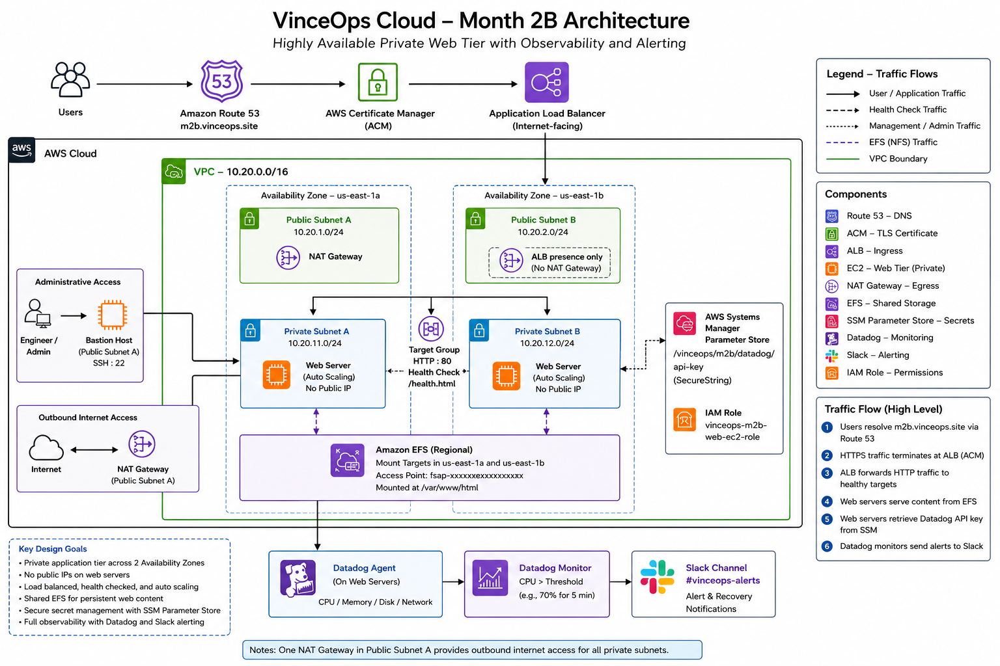

# Phase 02B | Private Infrastructure, Availability & Security Validation

> Evolution of the initial VinceOps public EC2 website into a layered AWS application architecture with private compute, managed load balancing, shared storage, and operational visibility.

**Scope:** A documented AWS laboratory implementation within the VinceOps fictional fintech scenario. This phase records architectural decisions and verification evidence rather than claiming a permanently running production platform.

## Engineering problem

The Phase 02 deployment demonstrated a secure public Nginx workload on an EC2 instance. A single publicly reachable instance, however, does not provide strong application-tier isolation or resilience. Phase 02B evaluates infrastructure patterns that separate internet-facing entry points from private compute and make health, shared state, and failure conditions observable.

## Implemented architecture

The project documents:

- Public and private subnets distributed across two Availability Zones, with private subnet routing and NAT-based egress.
- Layered access using an Application Load Balancer, security groups and restricted administrative connectivity.
- Private application compute with EC2 Launch Templates and Auto Scaling concepts tested in the lab.
- Amazon EFS for shared filesystem access from application instances.
- HTTPS listener configuration and application health verification.
- Datadog infrastructure monitoring and operational notifications through Slack.
- Troubleshooting of bootstrap, connectivity, health and monitoring issues.

[View architecture diagram](./architecture/vinceops-month-2b-architecture.png)

## Implementation evidence

The evidence is separated by infrastructure layer so reviewers can validate design decisions against representative test screenshots.

| Evidence area | What is demonstrated |
|---|---|
| [Networking](./evidence/01-networking/) | Multi-AZ subnets, IGW/NAT routing, private route associations |
| [Access and security](./evidence/02-security/) | ALB, bastion and private web-tier security controls |
| [Shared storage](./evidence/03-shared-storage/) | EFS mount targets, access point and shared-content checks |
| [Compute and scaling](./evidence/04-compute-autoscaling/) | Launch-template configuration |
| [Load balancing](./evidence/05-load-balancing/) | Target group health and HTTP application delivery |
| [DNS and HTTPS](./evidence/06-dns-https/) | HTTP/HTTPS listener behavior |
| [Observability](./evidence/07-observability/) | Datadog agent, CPU monitor and Slack alert/recovery evidence |
| [Troubleshooting](./evidence/08-troubleshooting/) | Network access and notification test evidence |

[Read the complete evidence register](./evidence/README.md)

## Engineering documentation

- [Architecture decisions](./decisions.md) — rationale, trade-offs and operating boundaries.
- [Troubleshooting record](./troubleshooting.md) — observed problems and corrective actions.
- [Bootstrap script](./scripts/web-server-bootstrap.sh) — versioned instance startup example.
- [Phase 02 secure web foundation](../02-Networking-Security/README.md) — predecessor milestone.
- [Portfolio home](../README.md) — all completed VinceOps phases.

## What this proves — and what it doesn't

The evidence demonstrates practical configuration and testing of multi-AZ networking, security boundaries, health checks, shared storage and alert delivery. It does not establish uninterrupted production operation, disaster-recovery guarantees or an independently measured availability service-level objective.

**Project progression:** The standalone Terraform networking and EC2 lab was completed in [Phase 06](../06-Infrastructure-as-Code/README.md). Integrated EKS infrastructure automation and broader observability remain future capstone work.
