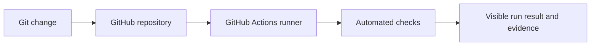

# Phase 03 | Continuous Integration Foundations

> Establishing repeatable GitHub Actions checks and understanding the difference between source control, build automation and deployment.

## Objective

Manual verification is inconsistent. VinceOps introduced GitHub Actions as a way to run repository checks when changes are submitted and to retain a visible record of validation.

## Scope of this milestone

This phase focuses on the introductory CI workflow and the operational troubleshooting involved in getting it recognized and running. The source file [`workflows/test.yml`](./workflows/test.yml) illustrates a checkout, simple repository checks and runner introspection.

The repository's **active workflow definitions** live in [`.github/workflows/`](../.github/workflows/). The illustrative workflow under this phase's `workflows/` directory is **not** itself an active GitHub Actions workflow because GitHub only executes workflow definitions from the repository's `.github/workflows/` directory.

## CI architecture

## Evidence and decisions

- [GitHub Actions workflow definition screenshot](./screenshots/workflow-definition.png)
- [Successful workflow run screenshot](./screenshots/workflow-success.png)
- [Troubleshooting record](./troubleshooting.md)
- [Introductory workflow source](./workflows/test.yml)

### How this evolved

The later milestones implement more substantial automation:

- [Kubernetes manifest validation](../.github/workflows/kubernetes-validation.yml)
- [Helm chart lint and schema validation](../.github/workflows/helm-validation.yml)
- [Frontend build, container smoke test, GHCR publish and GitOps promotion](../.github/workflows/vinceops-frontend-ci.yml)
- [Frontend delivery case study](../05-Kubernetes/project-05-ci-cd/README.md)

## Scope and limitations

The initial project proves familiarity with runner-based validation, workflow placement and troubleshooting. It is not presented as a full application release pipeline. The subsequent Kubernetes CI/CD project covers the actual end-to-end image promotion and GitOps-delivery implementation.

[Return to the portfolio](../README.md)
