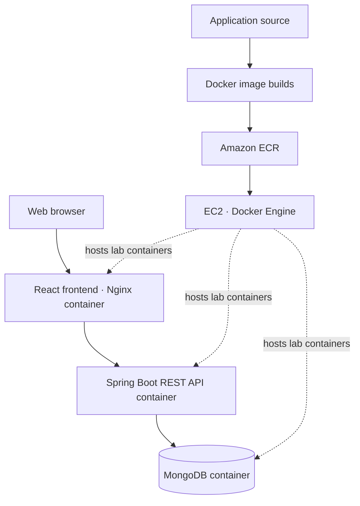

# Phase 04 | Containerized Full-Stack Movie Application

> Packaging and validating a movie application using React, Spring Boot, MongoDB, Docker and AWS application hosting.

## Engineering objective

VinceOps evaluated how to package a multi-component application so frontend, API and database services can be deployed and troubleshot independently of a developer's machine. The lab included Docker image builds, application testing, an EC2 hosting environment, and image publication to Amazon ECR.

## System architecture

This depicts the laboratory application's logical components, not a claim of a continuously hosted production service.

## Source and configuration

| Component | Repository location | Responsibility |
|---|---|---|
| React frontend | [`frontend/netflix_frontend/`](./frontend/netflix_frontend/) | Client interface, static production build and API integration |
| Spring Boot backend | [`backend/netflix_backend/`](./backend/netflix_backend/) | Movie API and business logic |
| Container configuration | [Frontend Dockerfile](./frontend/netflix_frontend/Dockerfile) · [Backend Dockerfile](./backend/netflix_backend/Dockerfile) | Image packaging |
| Nginx runtime | [`nginx.conf`](./frontend/netflix_frontend/nginx.conf) | Serving frontend content and health endpoint |
| Deployment notes | [`docs/deployment.md`](./docs/deployment.md) | Lab setup and verification record |

**Source provenance:** The movie application includes learning/reference application components; the [backend's source README](./backend/netflix_backend/README.md) records its originating project. The VinceOps contribution demonstrated here centers on container packaging, cloud deployment, validation and operational integration. Upstream attribution should be preserved when polishing that subproject's README.

## Verification evidence

The recorded demonstration includes screenshots for the following:

| Verification | Screenshot |
|---|---|
| EC2 laboratory host | [Instance evidence](./docs/screenshots/01-aws-ec2-running-instance.png) |
| Running containers | [Container status](./docs/screenshots/02-docker-production-containers-running.png) |
| Backend API response | [Health check](./docs/screenshots/03-backend-api-health-check-success.png) |
| Frontend accessibility | [Frontend verification](./docs/screenshots/04-frontend-application-accessible.png) |
| End-to-end application behavior | [Movie trailer test](./docs/screenshots/05-movie-trailer-production-success.png) |
| ECR artifacts | [Published images](./docs/screenshots/09-ecr-images-pushed.png) |

[Browse the entire deployment evidence directory](./docs/screenshots/).

## Platform progression

The React frontend code developed here is reused in [Kubernetes Project 05](../05-Kubernetes/project-05-ci-cd/README.md), where GitHub Actions validates and publishes images to GHCR and Argo CD manages deployment in K3s. This connects the container lab to the subsequent GitOps delivery track without implying the entire full-stack application was deployed through that later pipeline.

## Engineering lessons

- Container packaging separates runtime dependencies from the host environment.
- Multi-service applications require deliberate API networking and database connectivity.
- Health endpoints and runtime logs are important evidence beyond a successful image build.
- Image registries support reproducible distribution, while deployment orchestration is a separate concern.
- Verification evidence should be labeled as a recorded lab result, not continuous production availability.

[Return to the portfolio](../README.md)
