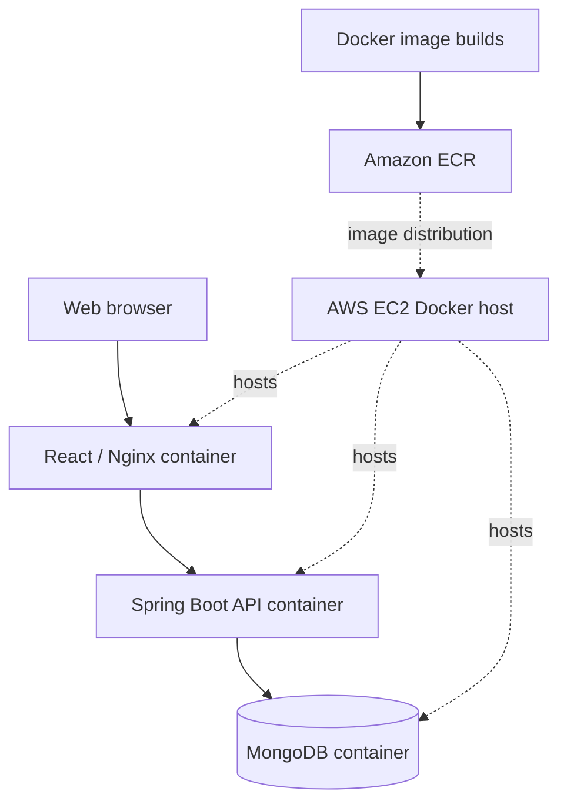

# Phase 04 — Containerized Application Deployment Record

## Summary

Phase 04 documented the packaging and deployment of a full-stack movie application on an AWS EC2 laboratory host.

The application comprised a React frontend, a Spring Boot API and MongoDB. Docker was used to package application components, and Amazon ECR was used to publish container images.

## Architecture

The diagram represents the logical deployment used in the lab, not a continuously running production environment.

## Implementation Record

| Engineering area | Recorded implementation |
|---|---|
| Application packaging | Docker images for frontend and backend |
| Deployment environment | AWS EC2 Ubuntu host |
| Application services | React, Spring Boot and MongoDB |
| Image registry | Amazon ECR |
| Application networking | Frontend-to-API and API-to-database communication |
| Verification | Container status, API response, frontend access and application playback |

## Validation Evidence

| Verification | Evidence |
|---|---|
| EC2 laboratory host | [EC2 instance](./screenshots/01-aws-ec2-running-instance.png) |
| Application containers | [Docker containers](./screenshots/02-docker-production-containers-running.png) |
| Backend API response | [Backend validation](./screenshots/03-backend-api-health-check-success.png) |
| Frontend accessibility | [Frontend validation](./screenshots/04-frontend-application-accessible.png) |
| Application behavior | [Movie playback](./screenshots/05-movie-trailer-production-success.png) |
| Image publication | [Amazon ECR](./screenshots/09-ecr-images-pushed.png) |

## Engineering Outcome

The recorded deployment demonstrated container packaging, cloud hosting, API connectivity, application-level testing and image publication to a container registry.

The lab established practical containerization experience subsequently extended through the VinceOps Kubernetes projects.

## Scope and Limitations

- The deployment was a temporary AWS laboratory exercise.
- Historical screenshots provide evidence of observed results, not current service availability.
- The recorded implementation is not presented as a high-availability production platform.
- Source provenance is recorded in the frontend and backend component READMEs.

[Phase 04 overview](../README.md)
