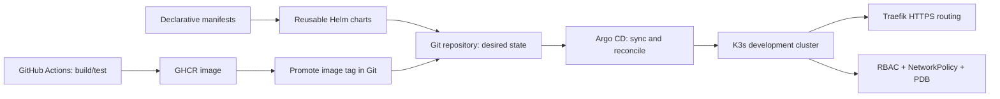

# Kubernetes Platform Engineering | VinceOps

This workstream develops a reusable cloud-native delivery platform for the VinceOps simulated fintech environment. The learning sequence progresses from fundamental workload reconciliation to automated GitOps delivery, networking, and namespace-scoped security.

## Completed project sequence

| Project | Implementation | Evidence |
|---|---|---|
| [01 — Kubernetes Fundamentals](./project-01-kubernetes-fundamentals/) | K3s Deployment and ClusterIP Service, replicas, Pod recovery, desired state | [Screenshots](./project-01-kubernetes-fundamentals/screenshots/) |
| [02 — Declarative Configuration](./project-02-declarative-configuration/) | Namespaces, ConfigMap content, updates, rollback and manifest checks | [Screenshots](./project-02-declarative-configuration/screenshots/) |
| [03 — Helm Packaging](./project-03-helm/) | Parameterized chart, ConfigMap volume integration, upgrade, rollback and lint | [Screenshots](./project-03-helm/screenshots/) |
| [04 — Argo CD / GitOps](./project-04-argocd-gitops/) | Application manifests, automated synchronization and reconciliation | [Screenshots](./project-04-argocd-gitops/screenshots/) |
| [05 — Frontend CI/CD](./project-05-ci-cd/) | React build, Docker smoke test, GHCR publication, automated Helm image promotion, Argo CD delivery | [Screenshots](./project-05-ci-cd/screenshots/) |
| [06 — Networking & Security](./project-06-networking-security-operations/) | Traefik Ingress, self-signed lab TLS, NetworkPolicy, RBAC checks, PDB and diagnostics | [Screenshots](./project-06-networking-security-operations/screenshots/) |

All six practical labs have been documented. Read each project's README for exact validation steps and unresolved limitations.

## Platform progression

## Implementation boundaries

- Labs used **temporary, primarily single-node K3s clusters** rather than an always-on production Kubernetes service.
- Project 05 demonstrates delivery of the frontend image, **not** a fully integrated React/Spring Boot/MongoDB platform inside Kubernetes.
- Project 06 demonstrates verified self-signed TLS routing and RBAC checks. The post-policy blocked connection was observed, but the captured pre-policy baseline was not conclusive enough to attribute blocking definitively to the NetworkPolicy.
- A PodDisruptionBudget regulates supported voluntary evictions; it does not make a single-node cluster highly available.
- **Terraform infrastructure automation belongs to the next workstream**, after this Kubernetes foundation.

## Working standards

1. Store manifests and Helm chart source next to the relevant project documentation.
2. Preserve sanitized console/terminal screenshots within `screenshots/`.
3. Validate manifests with Kubeconform and Helm charts with `helm lint` and `helm template`; then independently test against a live cluster where applicable.
4. Keep private keys, kubeconfigs, AWS credentials and Terraform state **out of version control**.
5. Treat README status as an evidence-based statement rather than a promise of continuous service.

[Back to VinceOps portfolio overview](../README.md)
