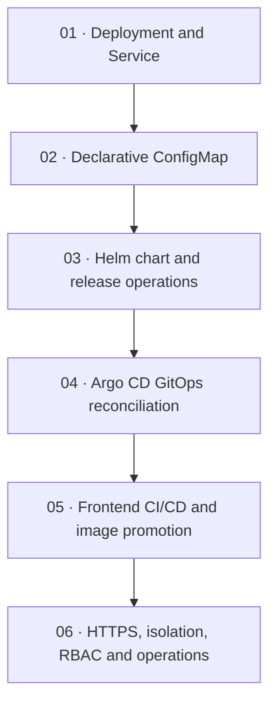

# Kubernetes Platform Engineering | VinceOps

> Six connected engineering projects demonstrating Kubernetes fundamentals, declarative operations, Helm, GitOps, automated container delivery, and cluster networking and security.

**Implementation:** Tested in temporary single-node K3s development labs. **Source:** [VinceOps GitHub repository](https://github.com/ops-vince/-Vinceops-cloud-).

## Project directory

| Project | Engineering focus | Verified outcome | Code & evidence |
|---|---|---|---|
| 01 — Kubernetes fundamentals | Deployments, Services, replica count and self-healing | Nginx service response; scale 3 → 5; Pod recreation; desired state restored | [Project 01](./project-01-kubernetes-fundamentals/README.md) |
| 02 — Declarative configuration | Namespaces and ConfigMap-mounted website | Web content update, rollback and restoration without rebuilding the container image | [Project 02](./project-02-declarative-configuration/README.md) |
| 03 — Helm release management | Reusable chart, templating, install, upgrade, rollback | Chart validation; configuration propagation troubleshooting; working v3 and v2 rollback evidence | [Project 03](./project-03-helm/README.md) |
| 04 — Argo CD / GitOps | Reconcile Git-defined Helm configuration | Synced/Healthy application, Git-backed configuration promotion and drift reconciliation | [Project 04](./project-04-argocd-gitops/README.md) |
| 05 — Container CI/CD | React frontend, GitHub Actions, GHCR, Helm and Argo CD | Image build, smoke test, SHA-based image promotion and healthy deployment | [Project 05](./project-05-ci-cd/README.md) |
| 06 — Networking, security & operations | Traefik HTTPS Ingress, NetworkPolicy, RBAC, PDB and diagnostics | HTTPS 200, five RBAC checks, two ready Pods and one allowed voluntary disruption | [Project 06](./project-06-networking-security-operations/README.md) |

## Platform progression



Projects 01–04 primarily use an Nginx learning workload; Projects 05–06 use a React frontend served by Nginx. They are connected engineering exercises, not one uninterrupted live cluster.

## How the delivery path works

```text
Frontend source change
  → GitHub Actions builds and tests React
  → Docker image is smoke-tested and published to GHCR
  → Commit-SHA image tag is promoted in the Helm values file
  → Argo CD reconciles the development namespace
  → Kubernetes Deployment runs the frontend behind a ClusterIP Service
  → Traefik Ingress routes HTTPS requests using a lab certificate
```

The specific workflow uses **commit-SHA image tags** for promotion; image digests can also be inspected through the registry. TLS terminates at Traefik, so the internal Service-to-Nginx path in Project 06 is HTTP.

## Source and evidence map

- [Declarative Kubernetes manifests](./project-02-declarative-configuration/manifests/) and [configuration evidence](./project-02-declarative-configuration/screenshots/)
- [Reusable Helm chart](./project-03-helm/vinceops-web/) and [release/rollback evidence](./project-03-helm/screenshots/)
- [Argo CD Application](./project-04-argocd-gitops/applications/) and [GitOps evidence](./project-04-argocd-gitops/screenshots/)
- [Frontend Helm chart](./project-05-ci-cd/chart/), [CI workflow](../.github/workflows/vinceops-frontend-ci.yml) and [delivery evidence](./project-05-ci-cd/screenshots/)
- [Security and operations manifests](./project-06-networking-security-operations/manifests/) and [live verification screenshots](./project-06-networking-security-operations/screenshots/)

## Validation and scope

- The [Kubernetes manifest validation workflow](../.github/workflows/kubernetes-validation.yml) currently checks the Project 02 manifests.
- The [Helm chart validation workflow](../.github/workflows/helm-validation.yml) currently checks the Project 03 chart.
- The [frontend CI workflow](../.github/workflows/vinceops-frontend-ci.yml) builds, tests, publishes and promotes the Project 05 frontend image on its configured triggers.
- Project 06's manifests were schema-validated with Kubeconform and tested in a K3s lab. **The blocked-connection observation is not by itself conclusive proof of NetworkPolicy enforcement**, because a successful pre-policy baseline was not captured. See the [Project 06 limitations](./project-06-networking-security-operations/README.md).
- The PDB limits supported voluntary evictions, not infrastructure failures. A one-node lab does not establish high availability.

## Engineering documentation standard

Each project contains a README explaining its purpose, architecture, implementation, observed outcomes, troubleshooting and evidence. Sensitive runtime artifacts such as Kubernetes administrator kubeconfigs, TLS private keys and SSH keys are not part of source control.

**Continuation:** Rather than maintaining independent unfinished Terraform or monitoring mini-projects, VinceOps will bring those concerns together in its **integrated capstone**.
