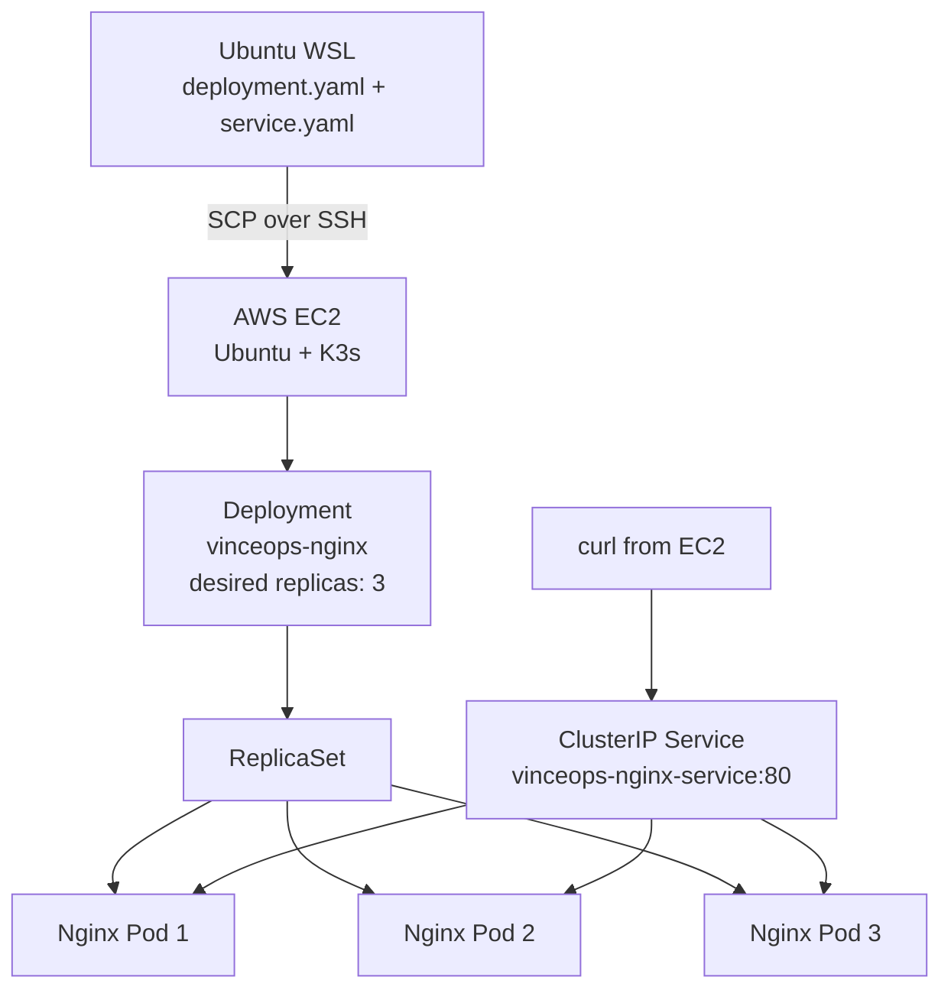
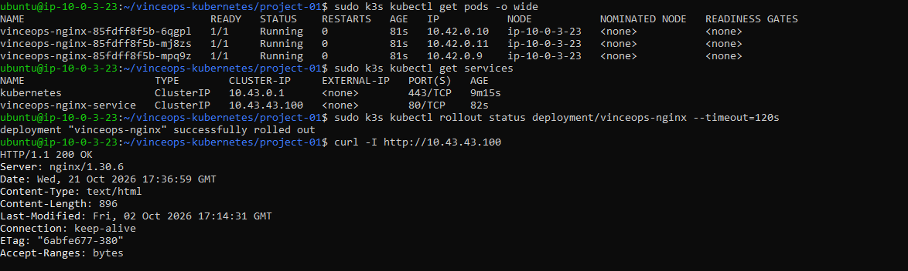
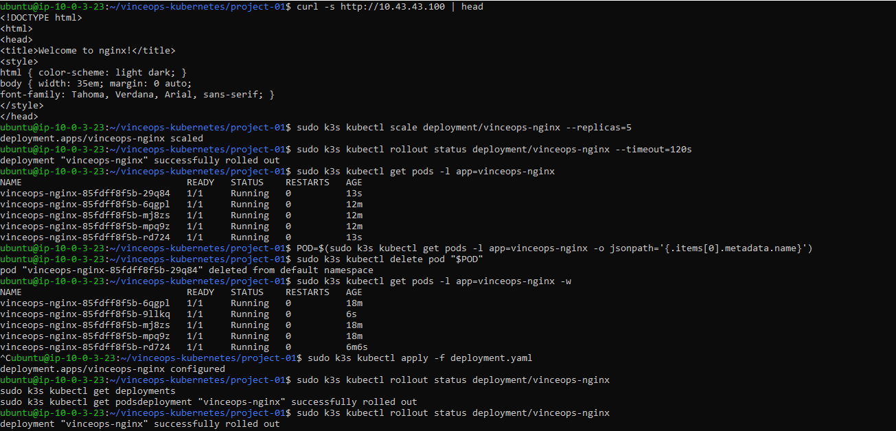
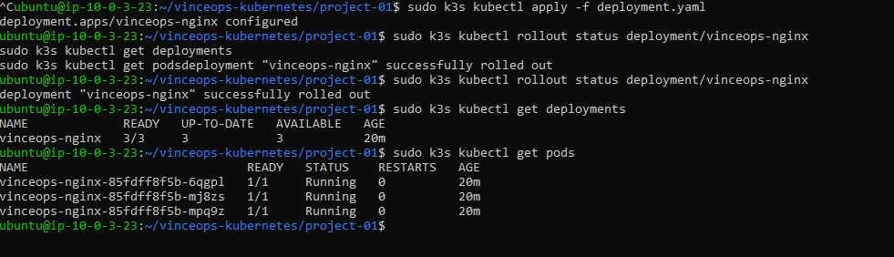

# Project 01 — Kubernetes Fundamentals: Nginx on K3s

**Status:** Completed  
**Environment:** Temporary AWS EC2 lab in `us-east-1`  
**Cluster:** Single-node K3s  
**Application:** Nginx  
**Cleanup:** The EC2 instance was terminated after evidence collection. The cluster is not currently running.

## 1. Objective

Deploy a containerized Nginx web server to Kubernetes and verify core orchestration behavior:

1. Install K3s on a temporary EC2 instance.
2. Declare an Nginx Deployment with three replicas.
3. Expose the Pods internally through a ClusterIP Service.
4. Verify that the Service returns an HTTP response.
5. Scale the Deployment from three to five replicas.
6. Delete one Pod and observe Kubernetes replace it.
7. Reapply the declarative manifest and restore three replicas.
8. Capture evidence and terminate the temporary lab.

## 2. Lab Environment

| Item | Observed value |
|---|---|
| AWS Region | `us-east-1` (N. Virginia) |
| EC2 instance type | `t3.medium` |
| Operating system | Ubuntu 24.04.4 LTS, x86-64 |
| Kubernetes distribution | K3s |
| K3s version shown | `v1.36.5+k3s1` |
| Container runtime shown | containerd |
| Cluster topology | One node acting as control plane and workload node |
| Container image in manifest | `nginx:stable-alpine` |
| HTTP result | `HTTP/1.1 200 OK` |
| Service type | `ClusterIP` |

The public IP is intentionally not recorded because it was an ephemeral lab address and is no longer needed.

## 3. Architecture



This was a single-node learning cluster, not a highly available production cluster. The Service was internal to Kubernetes; the test did not require opening public HTTP port 80 in the AWS security group.

## 4. Repository Files

- [`manifests/deployment.yaml`](./manifests/deployment.yaml) — declares the Nginx Deployment and three replicas.
- [`manifests/service.yaml`](./manifests/service.yaml) — creates a ClusterIP Service that selects the Nginx Pods.
- [`screenshots/`](./screenshots/) — evidence captured during the lab.

## 5. Deployment Manifest

The Deployment declares the desired state. Kubernetes controllers work to reconcile the actual state with that declaration.

```yaml
apiVersion: apps/v1
kind: Deployment
metadata:
  name: vinceops-nginx
  labels:
    app: vinceops-nginx
spec:
  replicas: 3
  selector:
    matchLabels:
      app: vinceops-nginx
  template:
    metadata:
      labels:
        app: vinceops-nginx
    spec:
      containers:
        - name: nginx
          image: nginx:stable-alpine
          ports:
            - containerPort: 80
          resources:
            requests:
              cpu: "50m"
              memory: "32Mi"
            limits:
              cpu: "250m"
              memory: "128Mi"
```

## 6. Service Manifest

The Service selector uses the same `app: vinceops-nginx` label applied to the Pod template. This label match allows the Service to select the intended Pods.

```yaml
apiVersion: v1
kind: Service
metadata:
  name: vinceops-nginx-service
  labels:
    app: vinceops-nginx
spec:
  type: ClusterIP
  selector:
    app: vinceops-nginx
  ports:
    - protocol: TCP
      port: 80
      targetPort: 80
```

## 7. Implementation and Verification

### Install and inspect K3s

The K3s installation script was run on the EC2 Ubuntu instance:

```bash
curl -sfL https://get.k3s.io | sh -
```

K3s was verified with:

```bash
sudo systemctl is-active k3s
sudo k3s kubectl get nodes -o wide
sudo k3s kubectl get pods -A
```

Observed result: the service was `active`, and the node reached `Ready`. During the first short check, the Traefik installation job temporarily showed an error; a later check showed the installation jobs completed and the Traefik Pod running.

### Apply the manifests

```bash
sudo k3s kubectl apply -f deployment.yaml
sudo k3s kubectl apply -f service.yaml
```

Inspect the resources:

```bash
sudo k3s kubectl get deployments
sudo k3s kubectl get pods -o wide
sudo k3s kubectl get services
sudo k3s kubectl rollout status deployment/vinceops-nginx --timeout=120s
```

Observed result: the Deployment showed `3/3` ready and available; all three Nginx Pods showed `1/1 Running`. The Service was named `vinceops-nginx-service`, with type `ClusterIP`, port `80/TCP`, and a cluster IP of `10.43.43.100` during this lab.

### Test the application

```bash
curl -I http://10.43.43.100
curl -s http://10.43.43.100 | head
```

Observed result: the HTTP request returned `HTTP/1.1 200 OK`, and the HTML included the default Nginx welcome page. The response identified the server as `nginx/1.30.6`.

### Scale from three to five replicas

```bash
sudo k3s kubectl scale deployment/vinceops-nginx --replicas=5
sudo k3s kubectl rollout status deployment/vinceops-nginx --timeout=120s
sudo k3s kubectl get pods -l app=vinceops-nginx
```

Observed result: five Nginx Pods became ready.

### Demonstrate self-healing

```bash
POD=$(sudo k3s kubectl get pods -l app=vinceops-nginx -o jsonpath='{.items[0].metadata.name}')
sudo k3s kubectl delete pod "$POD"
sudo k3s kubectl get pods -l app=vinceops-nginx -w
```

Observed result: the selected Pod was deleted and Kubernetes created a replacement to maintain the requested count of five replicas.

### Restore the declared state

```bash
sudo k3s kubectl apply -f deployment.yaml
sudo k3s kubectl rollout status deployment/vinceops-nginx
sudo k3s kubectl get deployments
sudo k3s kubectl get pods
```

Observed result: applying `deployment.yaml`, which declares `replicas: 3`, returned the Deployment to three ready and available replicas.

## 8. Key Learning

- A Deployment manages rollout history and ReplicaSets.
- A ReplicaSet controller works to maintain the requested number of matching Pods.
- The scheduler assigns unscheduled Pods to suitable nodes.
- The kubelet works to run the containers for Pods assigned to its node.
- A Service provides a stable internal endpoint and selects Pods using labels.
- A Pod being `Running` is not by itself proof that the application endpoint works; an HTTP test supplied that additional evidence.
- `kubectl scale` changed the live replica count, while `kubectl apply -f deployment.yaml` restored the replica count declared in the file.
- The cluster was a single-node learning environment and does not demonstrate multi-node high availability.

## 9. Evidence

### 01 — Service and HTTP verification



Shows the three running Pods, ClusterIP Service, successful rollout, `HTTP/1.1 200 OK`, and the Nginx HTML response.

### 02 — Scaling and self-healing



Shows scaling from three to five replicas, deletion of one Pod, and the replacement Pod appearing while Kubernetes maintains the requested count.

### 03 — Declarative replica restoration



Shows `kubectl apply -f deployment.yaml` followed by the Deployment returning to `3/3` ready and available replicas.

## 10. Troubleshooting Notes

- The first EC2 instance had only a private IPv4 address, so direct SSH from the local workstation timed out. The replacement lab instance was launched with a public IPv4 address and the SSH connection succeeded.
- The VPC route table initially shown had only a local route. The eventual working instance had network connectivity sufficient for SSH and K3s installation.
- The first K3s system-Pod listing was taken shortly after startup. A later listing showed the Traefik installation jobs completed and Traefik running.
- When recreating this lab, verify subnet routing and public-IP assignment before launching, restrict SSH to the current administrator IP, and do not expose the Kubernetes API publicly.

## 11. Cleanup

The user confirmed that the EC2 instance was terminated after the lab. Before repeating the lab, also verify that no unattached EBS volumes, unused Elastic IPs, or other billable resources remain.

## 12. Next Project

[Project 02 — Declarative Configuration](../project-02-declarative-configuration/) will build on this work by introducing a dedicated namespace, ConfigMaps, configuration updates, and a more organized declarative workflow.
