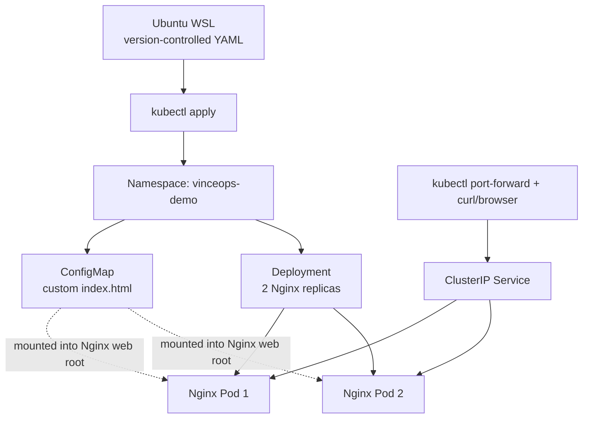

# Project 02 — Declarative Kubernetes Configuration

**Status:** Planned — not yet implemented  
**Cost approach:** Prepare and review manifests locally first; only start a temporary cluster when ready to test.

## 1. Objective

Build on Project 01 by organizing Kubernetes resources as version-controlled declarative configuration. Learn how namespaces, labels, selectors, ConfigMaps, and controlled configuration updates fit together.

Project 01 proved that `kubectl apply` can create a Deployment and Service. Project 02 will make configuration management more intentional and reproducible.

## 2. Learning Outcomes

By the end of this project, the goal is to be able to:

- Explain the difference between imperative commands and declarative manifests.
- Organize resources in a dedicated namespace.
- Keep non-sensitive application configuration separate from the container image.
- Use a ConfigMap to provide a custom Nginx welcome page.
- Apply and inspect changes using `kubectl apply`, `kubectl diff`, `kubectl describe`, and `kubectl get`.
- Verify how configuration changes appear in a running workload.
- Observe how labels and selectors connect the Service to the Deployment's Pods.
- Understand the purpose and limitations of Kubernetes Secrets without committing real credentials to Git.

## 3. Planned Architecture



This is the intended design, not a deployed result.

## 4. Planned Manifest Layout

```text
project-02-declarative-configuration/
├── README.md
└── manifests/
    ├── namespace.yaml
    ├── configmap.yaml
    ├── deployment.yaml
    └── service.yaml
```

The manifest files will be created and validated during the practical lessons. They are intentionally not included yet so that the implementation remains a guided learning exercise.

## 5. Implementation Plan

### Step 1 — Prepare locally

- Create the project directory in the local VinceOps workspace.
- Install or verify lightweight YAML/Kubernetes client tooling as needed.
- Write and review each manifest before starting AWS resources.

### Step 2 — Declare the namespace and ConfigMap

- Create namespace `vinceops-demo`.
- Define a ConfigMap containing a simple custom `index.html` page.
- Keep credentials and sensitive values out of the ConfigMap.

### Step 3 — Declare the Deployment and Service

- Deploy two Nginx replicas in the namespace.
- Mount the ConfigMap as the Nginx web-root content.
- Create a ClusterIP Service with a selector that matches the Pod labels.

### Step 4 — Validate and apply

- Review the manifest changes.
- Use `kubectl diff` where supported.
- Apply the manifests and inspect the Namespace, ConfigMap, Deployment, Pods, and Service.
- Verify the page through `kubectl port-forward` and `curl` or a browser.

### Step 5 — Change configuration declaratively

- Update the welcome-page text in the ConfigMap.
- Apply the change and observe when the mounted file reflects the update.
- Record whether a Pod restart is needed for the chosen mount pattern.
- Demonstrate that the saved YAML is the source of truth for the declared configuration.

### Step 6 — Secret-handling lesson

- Use only a clearly fake, disposable value if a Secret demonstration is included.
- Do not commit real credentials, tokens, private keys, or production Secret manifests.
- Remember that base64 encoding is not encryption. Production secret management requires additional controls and should be treated separately.

### Step 7 — Capture evidence and clean up

- Capture the manifest structure and successful resource status.
- Capture the custom page before and after the ConfigMap update.
- Record the commands, observations, and any troubleshooting.
- Terminate the temporary EC2 lab and check for leftover billable resources.

## 6. Acceptance Criteria

Project 02 will be marked complete only when the following are demonstrated:

- [ ] All resources are in the intended namespace.
- [ ] ConfigMap content is served by Nginx.
- [ ] Two replicas are Ready.
- [ ] Service selector matches the Pod labels.
- [ ] HTTP testing confirms the custom page is served.
- [ ] A declarative ConfigMap change is applied and its effect is verified.
- [ ] No real credentials or private keys are committed.
- [ ] Screenshots and command results are documented.
- [ ] Temporary AWS resources are cleaned up.

## 7. How This Leads to Helm

Once the plain YAML resources and their relationships are understood, Project 03 will package the configuration into a Helm chart. That progression is intentional: understand the resources first, then learn how Helm templates and values make them reusable.
