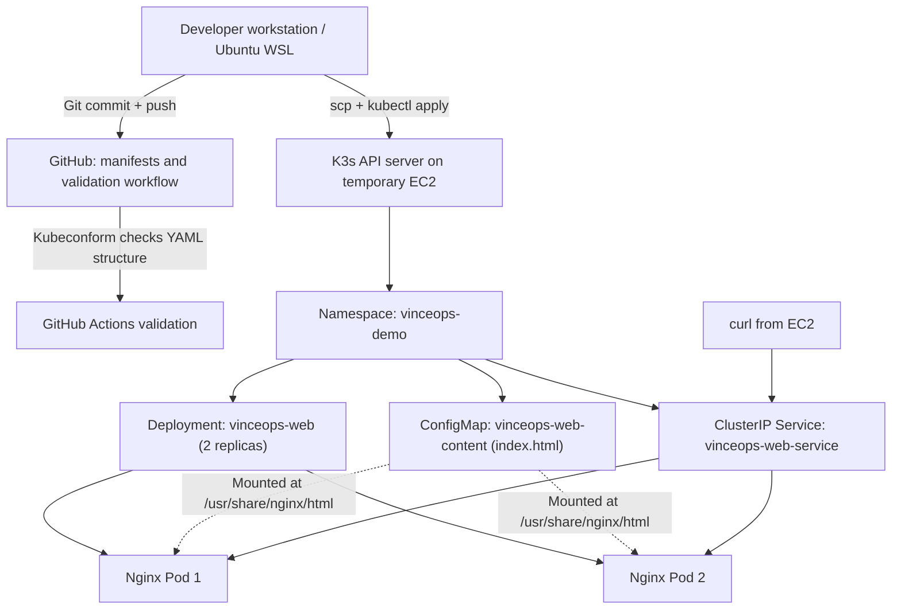
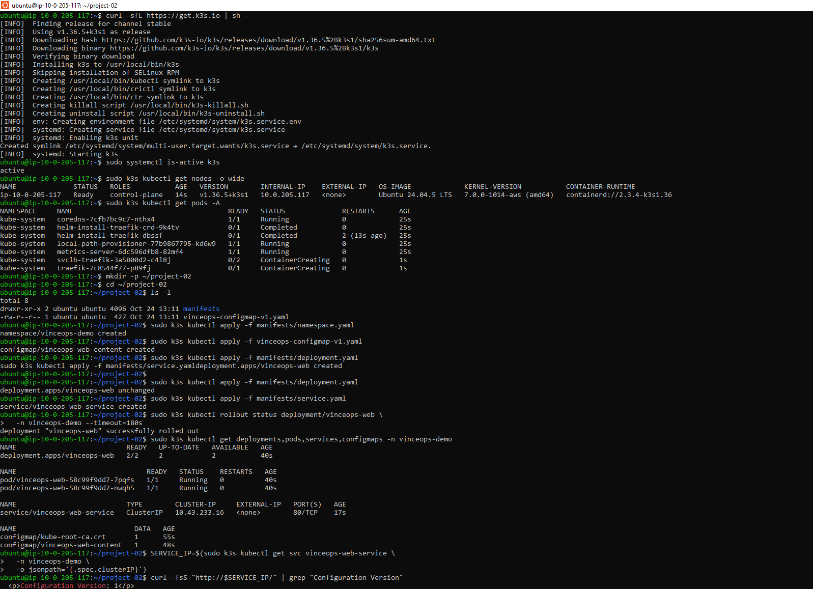
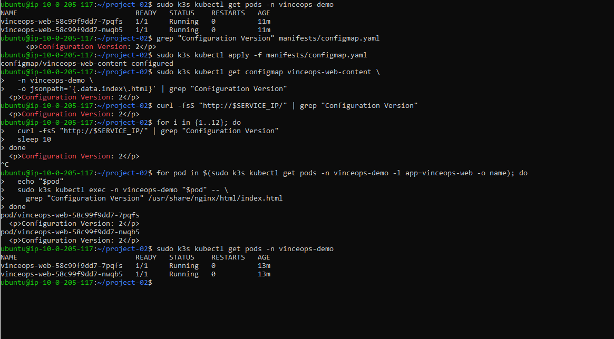
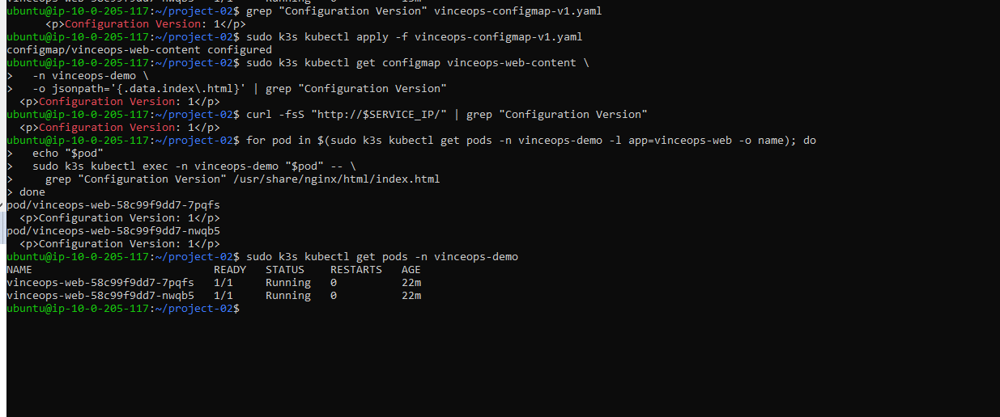
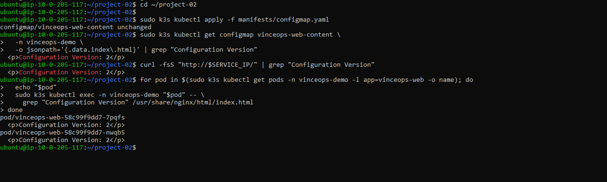
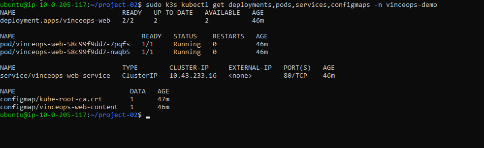
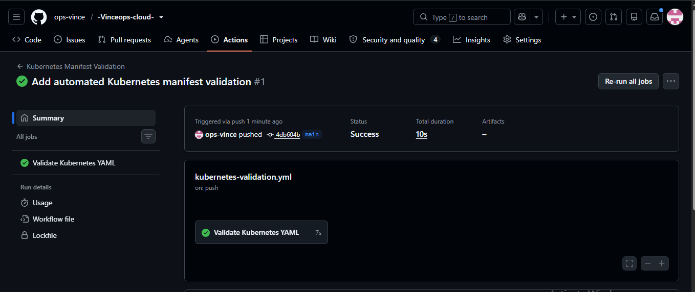

# Project 02 — Declarative Kubernetes Configuration and ConfigMap Change Management

**Status:** Live experiments completed; AWS cleanup must be confirmed separately.  
**Environment:** Temporary AWS EC2 Ubuntu instance running a single-node K3s cluster.  
**Application:** Nginx serving a static webpage supplied by a ConfigMap.  
**Code:** [`manifests/`](./manifests/) · **Evidence:** [`screenshots/`](./screenshots/)

## Overview

Project 02 builds on [Project 01 — Kubernetes Fundamentals](../project-01-kubernetes-fundamentals/) by managing application content declaratively. Rather than embedding every change in a rebuilt container image, the Nginx container mounts a Kubernetes ConfigMap as its web directory. The lab proves a configuration change, a rollback, and restoration of the Git-tracked desired content **without replacing the existing application Pods**.

The demonstration uses a two-replica Deployment, readiness checks, an internal ClusterIP Service, Kubernetes Namespaces and labels, and GitHub Actions manifest schema validation.

> This is a controlled single-node learning lab, not a highly available production environment. The EC2 instance is intended to be terminated after collecting evidence.

## Learning goals and achieved outcomes

| Objective | Evidence / outcome |
|---|---|
| Organize the application with a Namespace | `vinceops-demo` created and queried |
| Deploy workload declaratively | `vinceops-web` Deployment reached `2/2` Ready |
| Serve configuration external to the image | ConfigMap `vinceops-web-content` supplied `index.html` |
| Reach application through a Service | `vinceops-web-service` provided internal HTTP on port 80; `curl` returned the expected HTML |
| Update configuration without image rebuild | Version 1 → Version 2 observed at Service and inside both Pods |
| Roll back configuration | Version 2 → Version 1 observed at Service and inside both Pods |
| Restore desired version | Version 2 served again, matching the current repository manifest |
| Verify availability | Same two Pod names remained `Running`, `1/1 Ready`, with zero restarts |
| Validate manifests automatically | GitHub Actions `Kubernetes Manifest Validation` run showed success |

## Architecture



**Important:** GitHub Actions in this project validates the YAML. It does **not** automatically deploy or reconcile the cluster. The lab applied manifests through `kubectl`. Continuous Git-to-cluster reconciliation will be introduced later with Argo CD.

## Manifest breakdown

| File | Resource | Purpose |
|---|---|---|
| [`namespace.yaml`](./manifests/namespace.yaml) | Namespace | Logical scope `vinceops-demo` |
| [`configmap.yaml`](./manifests/configmap.yaml) | ConfigMap | Stores a custom HTML document as the `index.html` key; repository version is Version 2 |
| [`deployment.yaml`](./manifests/deployment.yaml) | Deployment | Creates 2 Nginx Pods with readiness checks and a ConfigMap-backed volume |
| [`service.yaml`](./manifests/service.yaml) | Service | Selects Pods with `app: vinceops-web` and exposes them internally on port 80 |

The Deployment's `volumes[].configMap.name` refers to `vinceops-web-content`. Its `volumeMounts[].name` refers to the volume `web-content`. The mounted path is `/usr/share/nginx/html`, where Nginx serves the `index.html` file.

Because the ConfigMap is mounted as a directory **without** `subPath`, Kubernetes can eventually project updates into the running Pods. Propagation may be delayed; a ConfigMap update does not force a Deployment rollout or image rebuild.

## Reproducing the lab

Prerequisites: an accessible K3s lab cluster; `kubectl` access; four manifests from this repository. In the original lab, K3s was installed on Ubuntu with `curl -sfL https://get.k3s.io | sh -`, and the commands below used `sudo k3s kubectl` on EC2. Do not open the Kubernetes API or SSH broadly to the internet.

### 1. Recover the original Version 1 config

The repository intentionally retains **Version 2** as its current desired state. Recover Version 1 from Git history on your local workstation:

```bash
git show bea309b:05-Kubernetes/project-02-declarative-configuration/manifests/configmap.yaml > /tmp/vinceops-configmap-v1.yaml
```

Transfer that file and the four `manifests/` files to the cluster host (the original lab used `scp`).

### 2. Apply Version 1 and the workload

From the directory containing `manifests/` and `vinceops-configmap-v1.yaml` on the cluster host:

```bash
sudo k3s kubectl apply -f manifests/namespace.yaml
sudo k3s kubectl apply -f vinceops-configmap-v1.yaml
sudo k3s kubectl apply -f manifests/deployment.yaml
sudo k3s kubectl apply -f manifests/service.yaml
sudo k3s kubectl rollout status deployment/vinceops-web -n vinceops-demo --timeout=180s
sudo k3s kubectl get deployments,pods,services,configmaps -n vinceops-demo
```

Check traffic from the EC2 host, where the ClusterIP is reachable:

```bash
SERVICE_IP=$(sudo k3s kubectl get service vinceops-web-service -n vinceops-demo -o jsonpath='{.spec.clusterIP}')
curl -fsS "http://$SERVICE_IP/" | grep 'Configuration Version'
```

**Observed:** `Configuration Version: 1`. The Deployment showed `2/2` ready replicas and two Pods running.

### 3. Change the ConfigMap to Version 2

```bash
sudo k3s kubectl apply -f manifests/configmap.yaml
sudo k3s kubectl get configmap vinceops-web-content -n vinceops-demo -o jsonpath='{.data.index\.html}' | grep 'Configuration Version'
curl -fsS "http://$SERVICE_IP/" | grep 'Configuration Version'
```

The ConfigMap data showed Version 2, the HTTP response showed Version 2, and both mounted Pod files eventually showed Version 2:

```bash
for pod in $(sudo k3s kubectl get pods -n vinceops-demo -l app=vinceops-web -o name); do
  echo "$pod"
  sudo k3s kubectl exec -n vinceops-demo "$pod" -- grep 'Configuration Version' /usr/share/nginx/html/index.html
done
```

Both Pods retained their identities and had `RESTARTS: 0`.

### 4. Roll back to Version 1

```bash
sudo k3s kubectl apply -f vinceops-configmap-v1.yaml
curl -fsS "http://$SERVICE_IP/" | grep 'Configuration Version'
```

**Observed:** Version 1 returned from the Service and was present in both Pods. The Pod names were unchanged and restart counts remained zero.

### 5. Restore Version 2

```bash
sudo k3s kubectl apply -f manifests/configmap.yaml
curl -fsS "http://$SERVICE_IP/" | grep 'Configuration Version'
sudo k3s kubectl get deployments,pods,services,configmaps -n vinceops-demo
```

**Observed:** Version 2 returned from the Service; both Pods contained Version 2. The final resource status showed a `2/2` Deployment, two running Pods with zero restarts, a ClusterIP Service, and the custom ConfigMap.

The response `configmap/vinceops-web-content unchanged` indicates the live resource already matched the applied configuration at that moment. In the final resource table, `DATA 1` counts the **number of ConfigMap data entries** (`index.html`); it is **not** the configuration's version.

## Verification evidence

### 01 — Initial deployment and Version 1 HTTP response



Initial K3s deployment, namespace, ConfigMap, two running Pods, ClusterIP Service, and Version 1 HTML retrieved via `curl`.

### 02 — Live update to Version 2



ConfigMap updated to Version 2; Service and both Pods served Version 2; original Pod names and zero restarts retained.

### 03 — Configuration rollback



Applying the earlier ConfigMap produced Version 1 again at the Service and in both Pods, without replacement.

### 04 — Desired Version 2 restored



Version 2 was confirmed again at the ConfigMap, Service, and both mounted files.

### 05 — Final Kubernetes resource status



Final command output showing `2/2` ready and available replicas, two running Pods, zero restarts, and the internal Service and ConfigMaps.

### 06 — CI manifest validation



GitHub Actions reported a successful Kubernetes YAML validation run. Schema validation supplements—but does not replace—live cluster testing.

## What this proves (and what it does not)

- The live application served static HTML projected from a ConfigMap, not from a rebuilt image.
- Kubernetes kept two existing Pods running throughout configuration changes and rollback.
- A ClusterIP provided an internal access point; it did **not** publish the application to the internet.
- The repository held the desired Version 2 manifest, while manual changes to the live ConfigMap temporarily created drift. The original lab did not use Argo CD.
- Readiness checks were configured, and the Pods appeared Ready. Failure-injection testing of the readiness probe was **not** performed in this project.
- This was a single-node lab; high availability, autoscaling, load testing, and production secret management were **not** demonstrated here.

## Operational lessons

1. `kubectl apply` updates the Kubernetes resource described by the YAML file; it does not create a Git commit or rebuild a container image.
2. Git tracks the desired configuration history. Changing a live cluster manually without updating Git can introduce drift.
3. ConfigMap volumes propagate updates eventually; applications that read configuration only once at startup may still need a restart, unlike this static-file example.
4. Check the whole flow when troubleshooting: ConfigMap data → projected file inside each Pod → Service HTTP response.
5. Kubernetes `Secret` resources are appropriate for secret values, but base64 encoding alone is not encryption. Do not commit real secrets or SSH private keys.

## Cleanup and next steps

**AWS cleanup:** After preserving evidence, terminate the temporary EC2 instance and confirm deletion of the attached EBS volume and release of any unused Elastic IP. Verify these actions in the AWS console; a completed Kubernetes lab does not automatically stop AWS billing. **Cleanup confirmation is recorded separately once verified.**

**Next:** Project 03 will package these manifests into a Helm chart with configurable values (for example, replica count and website content). The underlying Kubernetes concepts from Project 02 remain essential to interpreting Helm output and later Argo CD/GitOps behavior.
