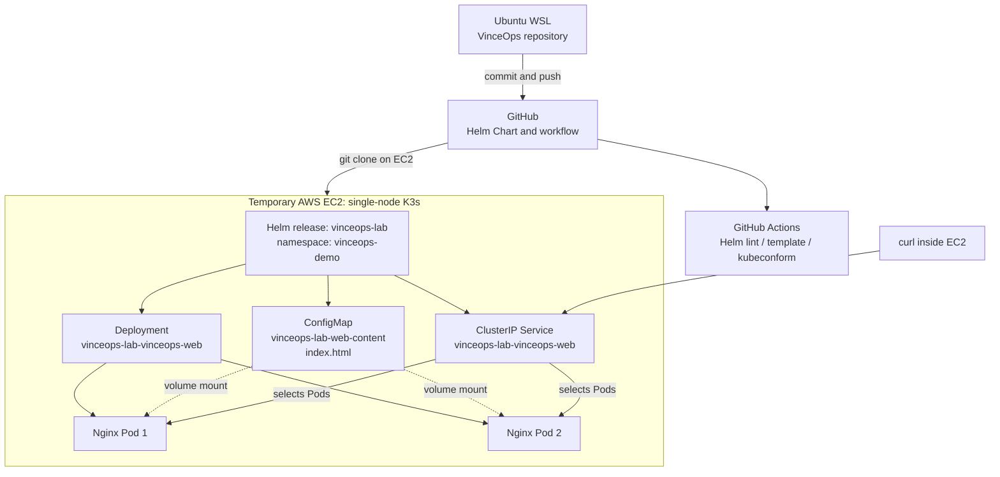
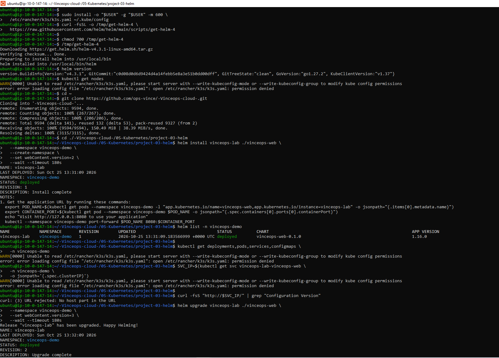
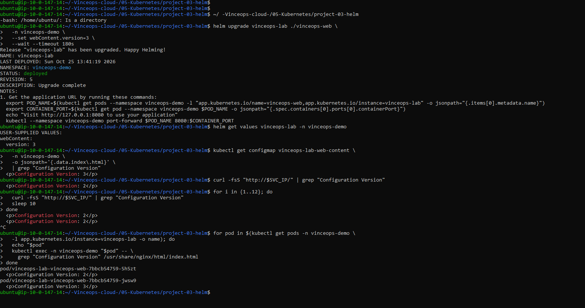
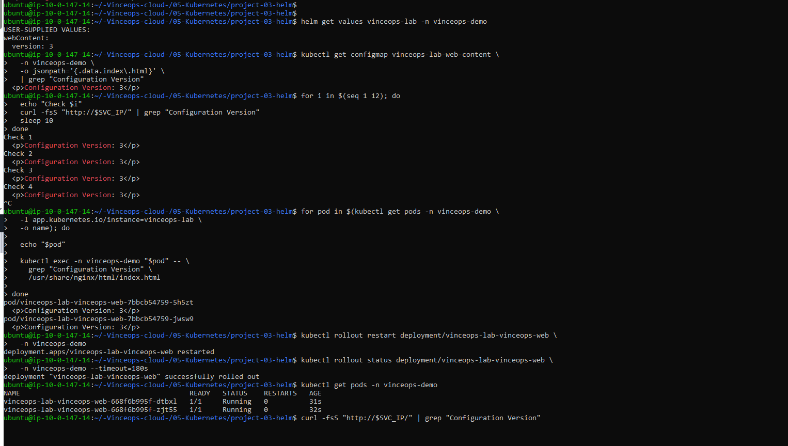
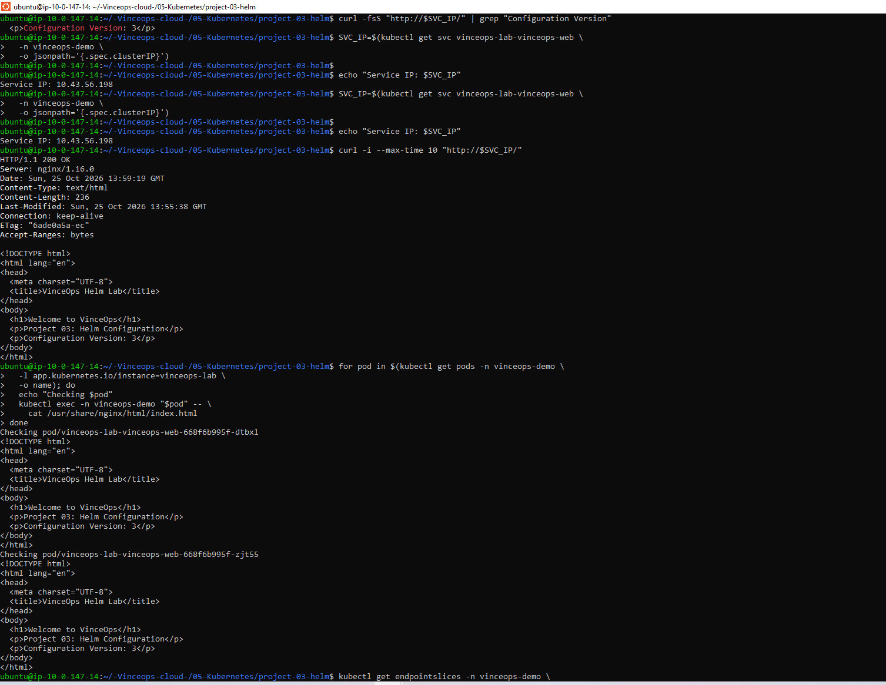
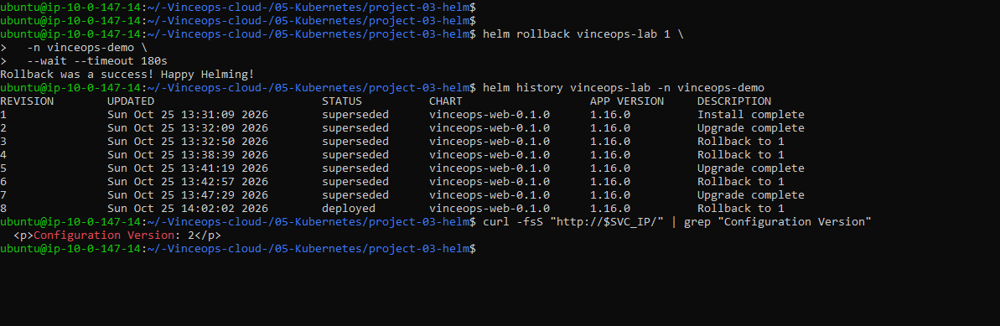

# Project 03 — Helm: Reusable VinceOps Nginx Release

**Status:** Helm Chart created, committed, and tested in a temporary K3s cluster; cloud-resource cleanup confirmation pending.  
**Lab date:** October 25, 2026  
**Repository:** [VinceOps — Kubernetes](https://github.com/ops-vince/-Vinceops-cloud-/tree/main/05-Kubernetes)  
**Chart source:** [`vinceops-web/`](./vinceops-web/)  
**Automated validation:** [`.github/workflows/helm-validation.yml`](../../.github/workflows/helm-validation.yml)

## Executive summary

This lab converted the manually managed Nginx Deployment, Service and ConfigMap from Project 02 into a reusable **Helm Chart**. We rendered manifests locally with different values, committed the chart to GitHub, configured a Helm-validation GitHub Actions workflow, and installed the release on a single-node K3s cluster hosted on a temporary AWS EC2 instance.

The practical test covered:

- **Install:** revision 1 with webpage Configuration Version 2.
- **Upgrade:** changed Helm value `webContent.version` to `3`; Helm created revision 2 and subsequent test upgrades.
- **Verification:** confirmed that the Kubernetes ConfigMap changed, inspected the HTML inside each Nginx Pod, and obtained an HTTP **200 OK** response for Configuration Version 3 through the Service.
- **Rollback:** restored revision 1 with `helm rollback`, observed Configuration Version 2 through the Service, and captured release history ending at **revision 8**.
- **Troubleshooting:** corrected kubeconfig file permissions, diagnosed why `helm --wait` did not guarantee immediate ConfigMap propagation, and inspected both Pods to distinguish a successful Helm operation from application-level readiness.

This is a **temporary, single-node learning lab**, not a production or high-availability deployment. The supplied evidence confirms observed commands and outputs from this run. It does not prove that the infrastructure is still running.

## Learning goals

1. Explain the difference between `helm template`, `helm install`, `helm upgrade`, and `helm rollback`.
2. Understand the roles of `Chart.yaml`, `values.yaml`, Go templates, and Helm release revisions.
3. Render multiple configurations without editing each Deployment manifest.
4. Package an application using a ConfigMap, Deployment, Service, and supporting resources.
5. Troubleshoot discrepancies between Helm's release status and the actual content served by an application.
6. Capture repeatable technical evidence and document limitations honestly.

## Architecture



**Key distinction:** Helm is a package/release manager, **not** a Kubernetes cluster. Helm renders and submits Kubernetes resources; Kubernetes controllers and node agents make the desired state real.

## Environment and configuration

| Item | Observed / configured |
|---|---|
| Host | Temporary AWS EC2 instance (Ubuntu, K3s) |
| Cluster | Single node, Kubernetes `v1.36.5+k3s1` shown |
| Helm CLI | `v4.3.1` shown |
| Namespace | `vinceops-demo` |
| Release name | `vinceops-lab` |
| Chart | `vinceops-web`, chart version `0.1.0` |
| Deployment | `vinceops-lab-vinceops-web` |
| Replicas | `2`, both Ready in resource listing |
| Service | `vinceops-lab-vinceops-web`, `ClusterIP`, `80/TCP` |
| Service IP observed | `10.43.56.198` (ephemeral lab value; not a fixed address) |
| ConfigMap | `vinceops-lab-web-content` |
| Mount | `/usr/share/nginx/html` |
| Image observed in HTTP response | `nginx/1.16.0` |
| Public ingress | Not implemented; HTTP tests ran from inside EC2 |

> **Image/version improvement needed:** The chart committed for this lab has `image.tag: ""` and `Chart.yaml` `appVersion: "1.16.0"`. The Deployment template uses `.Chart.AppVersion` when the image tag is empty, which explains the old `nginx/1.16.0` shown in the response. This was the tested configuration, but is **not recommended for production**. Update to a vetted, pinned image tag or immutable digest in a follow-up commit, test the change, and increment chart metadata appropriately. Do not claim a newer image was tested during this lab.

## Chart structure

The tracked Chart source is [`vinceops-web/`](./vinceops-web/). It contains these relevant files:

```text
project-03-helm/
├── README.md
├── screenshots/
│   ├── 01-helm-install-and-initial-troubleshooting.png
│   ├── 02-configmap-propagation-during-upgrade.png
│   ├── 03-configmap-propagation-verified.png
│   ├── 04-helm-version3-http-and-pods.png
│   └── 05-helm-final-rollback-and-history.png
└── vinceops-web/
    ├── Chart.yaml
    ├── values.yaml
    └── templates/
        ├── _helpers.tpl
        ├── configmap.yaml
        ├── deployment.yaml
        ├── service.yaml
        ├── serviceaccount.yaml
        ├── hpa.yaml
        ├── ingress.yaml
        ├── httproute.yaml
        └── tests/
            └── test-connection.yaml
```

The chart originated from `helm create vinceops-web`. HPA, Ingress and HTTPRoute were starter templates **not enabled in the live test**; their mere presence does not prove those features were deployed.

### Important values

The chart's `values.yaml` defines:

```yaml
replicaCount: 2

webContent:
  title: "Welcome to VinceOps"
  version: 2
```

The ConfigMap template reads the value with `{{ .Values.webContent.version }}`. The Deployment template mounts the corresponding release-specific ConfigMap at `/usr/share/nginx/html`. The ConfigMap is named using `{{ .Release.Name }}-web-content`.

These names must agree: the ConfigMap's metadata name and the Deployment volume's `configMap.name` must render to the same value.

### Release name vs replica count

`helm template vinceops-lab ./vinceops-web --set replicaCount=5` **generates** manifests requesting five replicas, but does not create Pods. A connected cluster is required for `helm install` or `helm upgrade`. A missing ConfigMap volume mount would not inherently prevent replicas from being created, but Nginx would not receive the custom HTML.

## Local preparation and validation

These commands ran (or were prepared) from the local Ubuntu WSL working tree:

```bash
cd "$HOME/-Vinceops-cloud-/05-Kubernetes/project-03-helm"

helm create vinceops-web
helm lint ./vinceops-web
helm template vinceops-lab ./vinceops-web \
  --namespace vinceops-demo \
  --set replicaCount=2 \
  --set webContent.version=2 \
  > /tmp/vinceops-final.yaml
```

Other rendering exercises demonstrated overrides:

```bash
helm template vinceops-lab ./vinceops-web \
  --namespace vinceops-demo --set replicaCount=4 \
  > /tmp/vinceops-four-replicas.yaml

helm template vinceops-lab ./vinceops-web \
  --namespace vinceops-demo --set webContent.version=3 \
  > /tmp/vinceops-helm-v3.yaml
```

The rendered ConfigMap contained the chosen `webContent.version`, and the rendered Deployment contained the chosen replica count.

### Continuous integration

GitHub contains a [`Helm Chart Validation` workflow](../../.github/workflows/helm-validation.yml) configured for updates under Project 03. It checks:

1. Helm chart linting.
2. Template rendering with two replicas and Version 2.
3. Kubernetes schema validation using Kubeconform.

This workflow is **static render/schema validation**, not a cluster deployment test. It does not exercise Helm upgrades, HTTP requests, or rollback. The workflow configuration was confirmed in the repository; the user reported that the workflow worked.

## Live lab: install, inspect, upgrade and roll back

The installation was performed from a clone of the VinceOps repository **inside EC2**, with K3s and Helm installed.

### 1. Initial release (Version 2)

The working project directory on EC2 was:

```bash
cd "$HOME/-Vinceops-cloud-/05-Kubernetes/project-03-helm"
```

The successful installation command was:

```bash
helm install vinceops-lab ./vinceops-web \
  -n vinceops-demo \
  --create-namespace \
  --set webContent.version=2 \
  --wait --timeout 180s
```

Observed result:

```text
NAME: vinceops-lab
NAMESPACE: vinceops-demo
STATUS: deployed
REVISION: 1
```

The release later showed two running Pods, a working ClusterIP Service, and the release-specific ConfigMap.

### 2. Upgrade the release to Version 3

```bash
helm upgrade vinceops-lab ./vinceops-web \
  -n vinceops-demo \
  --set webContent.version=3 \
  --wait --timeout 180s
```

Inspected the values stored for the current release:

```bash
helm get values vinceops-lab -n vinceops-demo
```

Observed:

```yaml
webContent:
  version: 3
```

Read the ConfigMap resource:

```bash
kubectl get configmap vinceops-lab-web-content \
  -n vinceops-demo \
  -o jsonpath='{.data.index\.html}' |
  grep "Configuration Version"
```

Observed `Configuration Version: 3`.

### 3. Verify both mounted files and HTTP response

The output initially differed across Pods: one Pod contained Version 2 while another contained Version 3, even though Helm and the ConfigMap reported Version 3. That was an **eventual ConfigMap volume propagation delay**, not proof of a failed Helm upgrade.

Later both existing Pods showed Version 3. A `kubectl rollout restart` was also performed during troubleshooting, creating replacement Pods, so the final running Pods were not necessarily the originally installed Pods.

Obtain the Service IP and verify application response:

```bash
SVC_IP=$(kubectl get svc vinceops-lab-vinceops-web \
  -n vinceops-demo -o jsonpath='{.spec.clusterIP}')

curl -i --max-time 10 "http://$SVC_IP/"
```

Final observed result:

```text
HTTP/1.1 200 OK
Server: nginx/1.16.0

<h1>Welcome to VinceOps</h1>
<p>Project 03: Helm Configuration</p>
<p>Configuration Version: 3</p>
```

Inspect both mounted files:

```bash
for pod in $(kubectl get pods -n vinceops-demo \
  -l app.kubernetes.io/instance=vinceops-lab -o name); do
  echo "$pod"
  kubectl exec -n vinceops-demo "$pod" -- \
    grep "Configuration Version" /usr/share/nginx/html/index.html
done
```

Both replacement Pods showed Version 3 in the final verification.

### 4. Roll back to original release configuration

```bash
helm rollback vinceops-lab 1 \
  -n vinceops-demo \
  --wait --timeout 180s
```

Inspect history and response:

```bash
helm history vinceops-lab -n vinceops-demo
curl -fsS "http://$SVC_IP/" | grep "Configuration Version"
```

Final observed history:

| Release revision | Operation | Status at final check |
|---|---|---|
| 1 | Install complete | superseded |
| 2 | Upgrade complete | superseded |
| 3 | Rollback to 1 | superseded |
| 4 | Rollback to 1 | superseded |
| 5 | Upgrade complete | superseded |
| 6 | Rollback to 1 | superseded |
| 7 | Upgrade complete | superseded |
| 8 | Rollback to 1 | **deployed** |

The final HTTP response contained **Configuration Version 2**. Helm's rollback created a new release revision; it did not delete the intervening history.

## Troubleshooting journal

| Problem | Evidence / root cause | Resolution |
|---|---|---|
| `kubectl` reported `permission denied` on `/etc/rancher/k3s/k3s.yaml` | `kubectl` attempted to read the root-owned K3s admin kubeconfig | Copied it to `~/.kube/config` with user ownership and mode `600`, then exported `KUBECONFIG="$HOME/.kube/config"` |
| `curl: (3) URL rejected: No host part in the URL` | `$SVC_IP` was empty because the earlier `kubectl` lookup failed | Fixed kubeconfig, retrieved the Service ClusterIP, then tested |
| Helm upgrade said `deployed`, but HTTP returned Version 2 | ConfigMap data had Version 3; mounted files had not refreshed in all Pods | Inspected ConfigMap and per-Pod HTML; allowed propagation; confirmed Version 3 |
| Restart briefly complicated the follow-up HTTP test | A manual Deployment rollout restart replaced Pods during investigation | Confirmed rollout completed, read HTML from both new Pods, and verified HTTP 200 |
| Multiple retries created more release history entries | Extra upgrades and rollbacks were run while diagnosing | Documented the actual final history (revisions 1–8), rather than presenting only a simplified three-revision example |

### Kubeconfig repair command used

```bash
mkdir -p "$HOME/.kube"
sudo install -o "$USER" -g "$(id -gn)" -m 600 \
  /etc/rancher/k3s/k3s.yaml "$HOME/.kube/config"
export KUBECONFIG="$HOME/.kube/config"
kubectl get nodes
```

**Security:** Never commit `~/.kube/config`, certificate keys, SSH private keys, tokens or access credentials into this repository.

### Why `--wait` did not prove the new webpage was visible

`helm upgrade --wait` waits for supported workload readiness conditions. A mounted ConfigMap changing does not necessarily alter the Pod template or make an existing healthy Pod unready. Therefore Helm may complete while one or more Pods still serve old ConfigMap content.

A future chart improvement is a **ConfigMap template checksum annotation** on the Deployment Pod template, which triggers a rolling replacement when rendered ConfigMap data changes. This was **not implemented in the tested chart**; the present lab instead demonstrates eventual propagation and a manual restart.

## Evidence

### 01 — Helm install and initial kubeconfig issue



Helm revision 1 deployed successfully while initial direct `kubectl` calls failed due to kubeconfig permissions.

### 02 — ConfigMap propagation discrepancy



Shows Helm upgrade activity and inconsistent mounted configuration across replicas during investigation.

### 03 — Version 3 propagated into both existing Pods



Demonstrates the Kubernetes ConfigMap and both Pod-mounted files containing Version 3 before the manual Deployment restart.

### 04 — Version 3 confirmed through HTTP and both Pods



Shows HTTP `200 OK` from Nginx, the Version 3 HTML, and both updated Pods serving the expected content.

### 05 — Final Helm rollback and revision history



Shows successful rollback to revision 1, release history ending with revision 8 deployed, and an HTTP response containing Version 2.

## Results and limitations

**Demonstrated**

- A reusable Helm Chart rendered the Nginx application resources.
- Helm value overrides changed replica counts and generated webpage content locally.
- Helm installed a release and recorded upgrade/rollback revisions.
- The ConfigMap volume made custom HTML available to Nginx.
- The Service returned HTTP 200 and Version 3 after an upgrade.
- The final rollback restored Version 2 through the Service.
- Kubeconfig access and delayed ConfigMap propagation were diagnosed.

**Not demonstrated / not production-ready**

- High availability across multiple Kubernetes nodes.
- Public ingress, TLS, authentication, network policies or managed secret distribution.
- Automated canary or rolling content verification during a ConfigMap change.
- Automatic ConfigMap-checksum-triggered rollouts (planned improvement).
- A tested modern pinned Nginx image; the evidence shows nginx/1.16.0.
- An always-running production cluster.
- Completed AWS teardown (**must be confirmed separately**).

## AWS cleanup — confirmation required

Once screenshots and any other desired outputs have been saved:

1. Terminate the temporary Project 03 EC2 instance in AWS.
2. Verify the EBS volume configured for deletion was actually removed.
3. Release unused Elastic IP allocations; also check for any other allocated public IPv4 resources that are no longer needed.
4. Verify no other unintended billable resources were left by the lab.
5. Update this README with cleanup confirmation only after checking.

**Cleanup status:** Not yet independently confirmed as of documentation preparation. Do not mark complete without checking AWS.

## Next steps

1. Update the Helm Chart's old Nginx version to a vetted, pinned version or digest and test it.
2. Add a ConfigMap checksum annotation to the Pod template for more predictable content rollouts.
3. Rerun the existing Helm validation GitHub Actions workflow after code changes.
4. Proceed to Project 04: Argo CD and GitOps, where a controller reconciles chart/configuration changes stored in Git rather than relying on manual Helm commands.

---

**Technical takeaway:** A successful Helm release action is not the same thing as end-to-end application verification. The reliable approach is to inspect release values, Kubernetes resources, mounted files in each replica, and the actual HTTP response.
