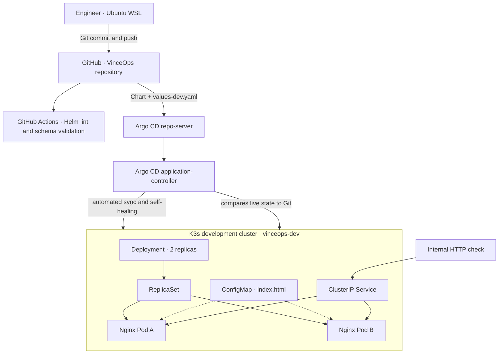
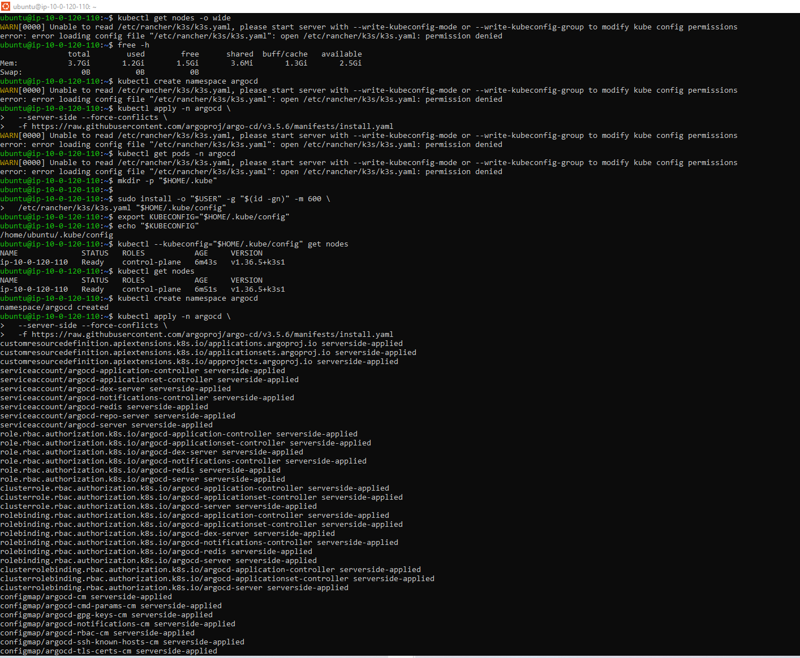
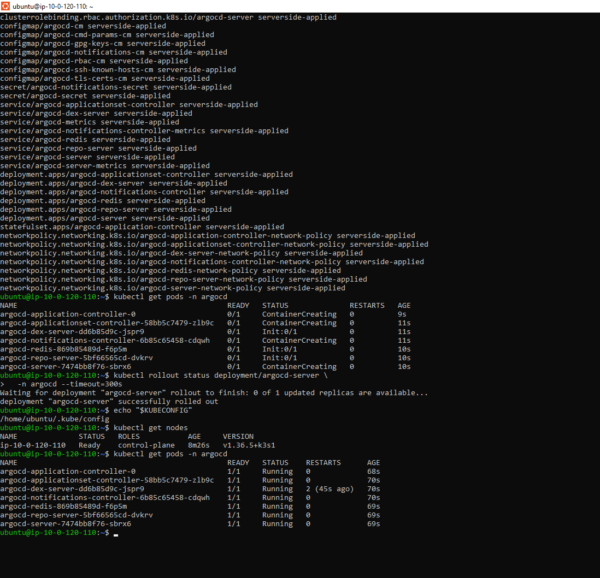
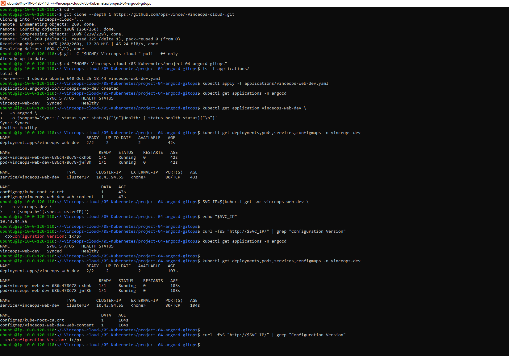
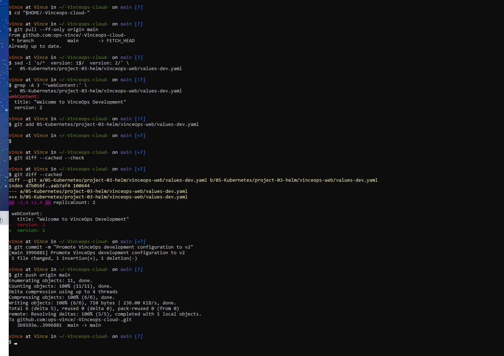
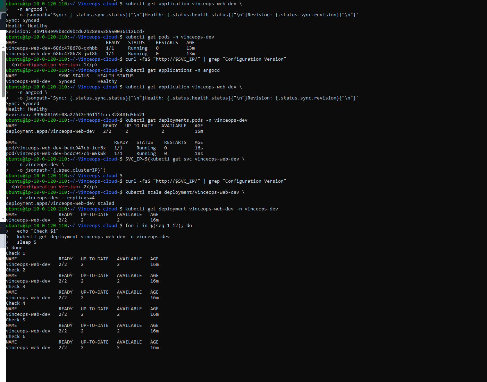
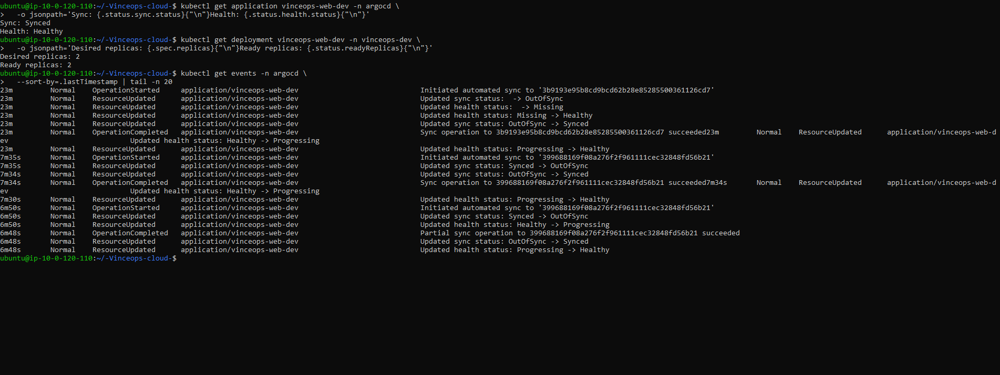
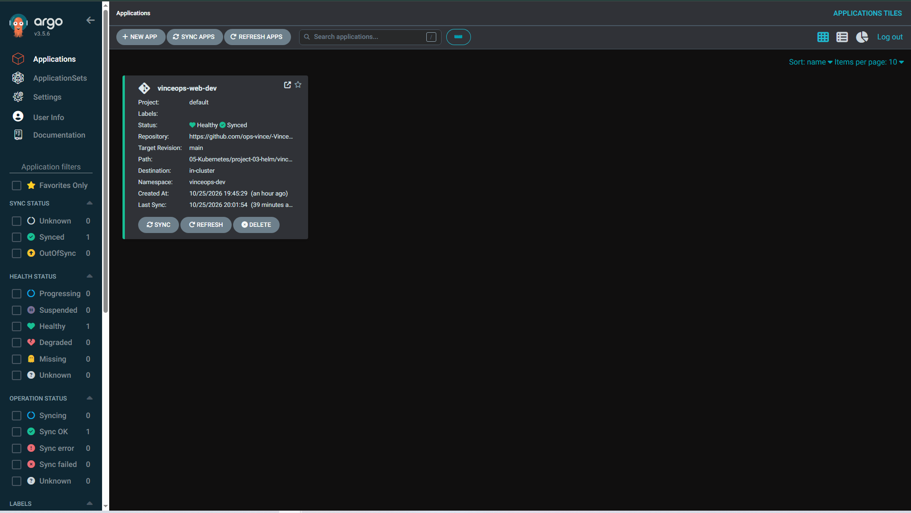
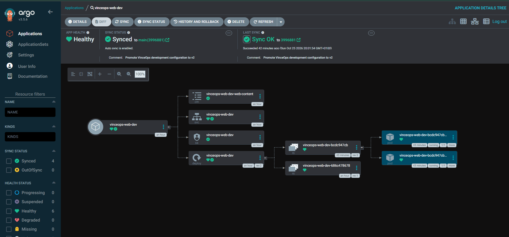

# GitOps Delivery Platform — Argo CD

**VinceOps | Kubernetes Engineering · Project 04**  
**Implementation:** completed and verified · **Environment:** development (single-node K3s)  
**Deployment model:** Git-driven declarative reconciliation

## Overview

VinceOps implemented a GitOps delivery workflow that deploys a Helm-rendered Nginx application to Kubernetes using **Argo CD**. The application configuration is maintained in GitHub, while Argo CD tracks the desired state, applies resource changes, and reconciles live-cluster drift.

The implementation demonstrated three core capabilities:

1. **Bootstrap:** register an Argo CD `Application` pointing to the existing VinceOps Helm Chart and development values.
2. **Git-driven promotion:** commit a website configuration change from Version 1 to Version 2; Argo CD reconciles the cluster automatically without an operator running `helm upgrade`.
3. **Drift reconciliation:** deliberately scale the development Deployment away from its Git-defined replica count; observe an additional Argo CD sync against the same commit and recovery of the desired two replicas.

This is an engineering **development-environment demonstration**, not a claim of multi-cluster or production-grade availability.

## System architecture



**Division of responsibility:**

| Component | Role |
|---|---|
| GitHub | Authoritative source for the development environment's desired configuration |
| Helm Chart | Renders parameterized Kubernetes manifests from templates and environment values |
| Argo CD repo-server | Fetches repository source and generates manifests |
| Argo CD application-controller | Determines synchronization and health status, initiates reconciliation |
| Kubernetes Deployment | Manages the desired Pod replicas and rolling updates |
| Kubernetes ConfigMap | Provides the custom `index.html` served by Nginx |
| Kubernetes Service | Routes internal HTTP requests to healthy application Pods |

> **Helm integration:** Argo CD invokes Helm to *render manifests* and then manages the resulting Kubernetes resources. This workflow is not the same as `helm install` and does not use Helm release revisions in the way Project 03 did.

## Source of truth and repository structure

```text
05-Kubernetes/
├── project-03-helm/
│   └── vinceops-web/
│       ├── Chart.yaml
│       ├── values.yaml
│       ├── values-dev.yaml          # Development environment values
│       └── templates/
│           ├── configmap.yaml
│           ├── deployment.yaml      # ConfigMap checksum in Pod template
│           └── service.yaml
└── project-04-argocd-gitops/
    ├── README.md
    ├── applications/
    │   └── vinceops-web-dev.yaml   # GitOps Application definition
    └── screenshots/
        └── ... eight verification images ...
```

Relevant source references:

- [GitOps Application manifest](./applications/vinceops-web-dev.yaml)
- [Helm development values](../project-03-helm/vinceops-web/values-dev.yaml)
- [Helm Deployment template](../project-03-helm/vinceops-web/templates/deployment.yaml)
- [Helm Chart](../project-03-helm/vinceops-web/)
- [Helm validation workflow](../../.github/workflows/helm-validation.yml)

The Argo CD Application uses these core settings:

```yaml
metadata:
  name: vinceops-web-dev
  namespace: argocd
spec:
  source:
    repoURL: https://github.com/ops-vince/-Vinceops-cloud-.git
    targetRevision: main
    path: 05-Kubernetes/project-03-helm/vinceops-web
    helm:
      valueFiles: [values-dev.yaml]
  destination:
    server: https://kubernetes.default.svc
    namespace: vinceops-dev
  syncPolicy:
    automated:
      selfHeal: true
      prune: false
    syncOptions:
      - CreateNamespace=true
```

`selfHeal: true` enables reconciliation after live drift. `prune: false` intentionally avoids automatically deleting resources removed from source control during this development demonstration.

## Configuration delivery workflow

### 1. Bootstrap the GitOps Application

Argo CD v3.5.6 was installed on a temporary single-node K3s cluster. The source-controlled Application was registered with:

```bash
kubectl apply -f   05-Kubernetes/project-04-argocd-gitops/applications/vinceops-web-dev.yaml
```

This bootstrapping command creates the Argo CD **Application** Custom Resource. The Nginx Deployment, ConfigMap and Service are then generated and synchronized by Argo CD rather than being manually applied as separate manifests.

### 2. Verify initial reconciliation

```bash
kubectl get applications -n argocd
kubectl get deployments,pods,services,configmaps -n vinceops-dev
```

**Observed:** the Application reached `Synced` and `Healthy`; the Deployment had **2/2 available replicas**, both Nginx Pods were Running, and the service returned:

```html
<p>Configuration Version: 1</p>
```

### 3. Promote development configuration through Git

The application values in `values-dev.yaml` changed from:

```yaml
webContent:
  title: "Welcome to VinceOps Development"
  version: 1
```

to:

```yaml
webContent:
  title: "Welcome to VinceOps Development"
  version: 2
```

This change was committed as **[`3996881`](https://github.com/ops-vince/-Vinceops-cloud-/commit/399688169f08a276f2f961111cec32848fd56b21)** (*Promote VinceOps development configuration to v2*) and pushed to `main` from the engineer's local Ubuntu WSL environment.

**No manual Helm upgrade or `kubectl apply` was used for this application change.** Argo CD detected and synchronized the Git revision. Subsequent evidence showed the Deployment at **2/2** ready, new ReplicaSet/Pod identifiers following the rollout, and an HTTP response containing:

```html
<p>Configuration Version: 2</p>
```

### 4. Trigger rolling updates with a ConfigMap checksum

The Helm Deployment template contains:

```yaml
annotations:
  checksum/config: {{ include (print $.Template.BasePath "/configmap.yaml") . | sha256sum }}
```

When rendered ConfigMap content changes, this checksum changes the Deployment's Pod template. Kubernetes therefore performs a rolling update rather than relying exclusively on eventual propagation into existing ConfigMap mounts. Local rendering checks confirmed that Versions 1 and 2 produced **different checksum values**.

### 5. Demonstrate live-state drift reconciliation

The development Deployment was deliberately changed away from the Git-defined replica count:

```bash
kubectl scale deployment/vinceops-web-dev   -n vinceops-dev --replicas=4
```

The final cluster readback returned:

```text
Sync: Synced
Health: Healthy
Desired replicas: 2
Ready replicas: 2
```

The Argo CD event stream recorded a subsequent automatic sync **to the same Git revision** (`3996881`) with `OutOfSync → Synced` and `Progressing → Healthy` transitions. Together with the manual scale command and the final state, this supports the observed reconciliation of live drift. The intermediate four-replica state was **not captured clearly** in a separate screenshot; no claim is made that it was.

### 6. Verify application topology

The Argo CD web dashboard showed `vinceops-web-dev` as **Synced / Healthy**, with the ConfigMap, Service, ServiceAccount, Deployment, multiple ReplicaSet revisions, and two running Pods. The dashboard was accessed via a local SSH tunnel/port-forward rather than exposed as an internet-facing service.

## Results

| Acceptance criterion | Verified outcome | Evidence |
|---|---|---|
| Argo CD installed and operational | Main components Running; controller, repo-server and API server available | [01](./screenshots/01-k3s-argocd-installation.png), [02](./screenshots/02-argocd-components-running.png) |
| Baseline deployment | `Synced`, `Healthy`, 2/2 Ready, webpage Version 1 | [03](./screenshots/03-initial-gitops-sync-version1.png) |
| Git-driven configuration promotion | Git commit `3996881` updates version from 1 to 2 | [04](./screenshots/04-github-promotion-to-version2.png) |
| Argo CD reconciles Git change | `Synced`, `Healthy`, new Pods, webpage Version 2 | [05](./screenshots/05-automatic-sync-version2.png) |
| Drift correction | Extra auto-sync to same revision; final desired and ready replica count 2 | [06](./screenshots/06-reconciliation-and-self-healing-events.png) |
| Dashboard and resource topology | Application Healthy/Synced; managed resources visible | [07](./screenshots/07-argocd-applications-dashboard.png), [08](./screenshots/08-argocd-resource-tree-redacted.png) |

## Evidence gallery

### 01 — Cluster preparation and Argo CD installation


### 02 — Argo CD control-plane components running


### 03 — Initial GitOps synchronization (Version 1)


### 04 — Git-backed configuration promotion


### 05 — Argo CD sync to Version 2


### 06 — Automated reconciliation events and restored replica count


### 07 — Argo CD Applications dashboard


### 08 — Argo CD managed resources and rollout topology


*The dashboard resource-tree screenshot has its personal author email metadata redacted; the Git revision and technical status remain readable.*

## Engineering decisions and scope

- **Deployment source:** all desired application configuration lives in Git, with the same reusable Helm Chart from Project 03.
- **Environment separation:** `values-dev.yaml` provides a development override without duplicating resource templates.
- **Controlled sync:** automatic synchronization and self-healing are enabled for the development environment; automatic deletion (`prune`) remains disabled.
- **Change-driven rollout:** checksum annotation makes ConfigMap changes produce a new Pod template and ReplicaSet.
- **Verification:** command success alone is insufficient. Release health, Git revision, Pods, and HTTP responses were inspected independently.
- **Security:** Argo CD access was kept behind SSH port forwarding. Public screenshots contain no administrator password or kubeconfig; the author email shown in the dashboard was redacted.

### Current limitations / future improvements

The exercise uses a single-node development environment and Argo CD's default project. A more advanced platform should use constrained `AppProject` RBAC, dedicated service identities, protected branches, review/approval gates, pinned images, immutable release references, monitoring, secret management and multi-environment promotion policies. None of those improvements are claimed as completed here.

## Next integration milestone

**Project 05 — CI/CD delivery:** connect test/build/publish automation to GitOps. CI should publish a container image and update a versioned deployment reference in Git, and Argo CD should reconcile the approved image change into Kubernetes. This separates *building an artifact* from *deploying desired state*, an important boundary for platform engineering.
