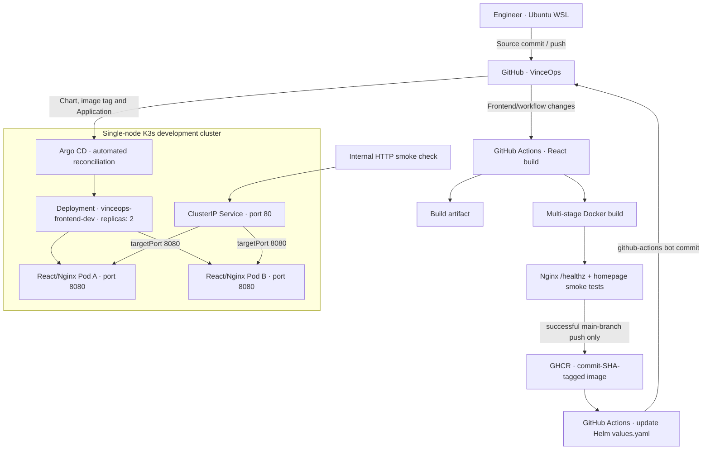
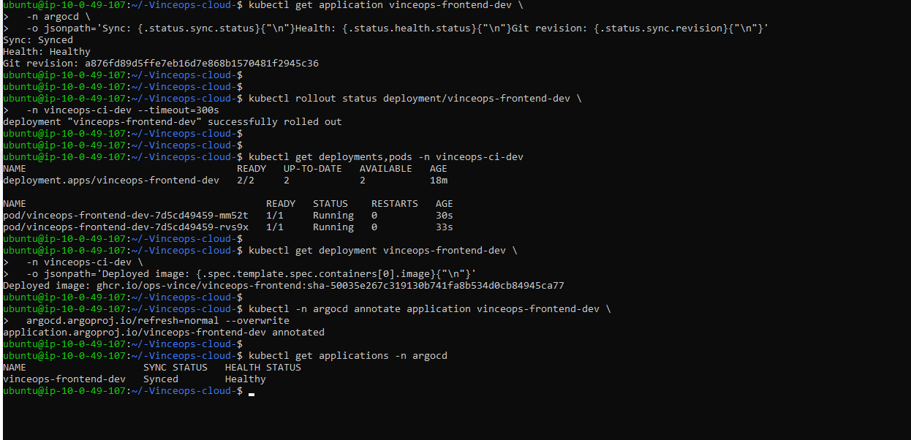

# Frontend Delivery Platform — CI/CD, GHCR and GitOps

**VinceOps | Kubernetes Engineering · Project 05**  
**Implementation:** Completed and verified in a development environment · **Validation date:** 26 October 2026  
**Delivery model:** Source commit → GitHub Actions CI → OCI image in GHCR → GitOps commit → Argo CD → Kubernetes

## Executive summary

VinceOps implemented a Git-driven delivery pipeline for its existing **React movie frontend**. The pipeline builds the application, creates a runtime container image, smoke-tests that container, publishes an immutable commit-tagged image to **GitHub Container Registry (GHCR)**, and updates the image reference in a source-controlled Helm Chart. **Argo CD** observes that chart and reconciles a separate development workload on Kubernetes.

The implementation was validated end to end: a change to the frontend API configuration in Git commit [`50035e2`](https://github.com/ops-vince/-Vinceops-cloud-/commit/50035e267c319130b741fa8b534d0cb84945ca77) triggered successful CI run [#5](https://github.com/ops-vince/-Vinceops-cloud-/actions/runs/40400704599). The workflow published the image and committed the promoted tag as [`a876fd8`](https://github.com/ops-vince/-Vinceops-cloud-/commit/a876fd89d5ffe7eb16d7e868b1570481f2945c36). Argo CD subsequently reported **Synced / Healthy**, the Deployment had **2/2 available replicas**, and the cluster was running the image tagged with the original source commit SHA.

The demonstrated capability is **automated frontend image delivery**, not a claim of end-to-end movie application functionality or a production-ready, highly available platform. The Spring Boot API and database were **not** deployed as part of this Project 05 Kubernetes validation.

## Architecture



### Responsibility boundaries

| Component | Responsibility |
|---|---|
| React frontend | Provides the compiled static user interface; Axios calls `/api/v1/...` endpoints. |
| Multi-stage Dockerfile | Builds with Node.js, then serves static assets using unprivileged Nginx on port `8080`. |
| GitHub Actions | Runs build validation, image packaging, container HTTP checks, publication and GitOps promotion. |
| GHCR | Stores the image built from a specific source commit. |
| Helm Chart | Declares Deployment replica count, container image, CPU/memory allocations, probes and ClusterIP Service. |
| Argo CD | Reads the desired Helm configuration from Git and synchronizes Kubernetes. |
| Kubernetes | Reconciles the Deployment, provisions Pods, and routes internal traffic through the Service. |

**GitOps distinction:** The pipeline does not invoke `kubectl apply`, `helm upgrade` or direct deployment commands as its release mechanism. It **changes Git**; Argo CD reads the resulting desired state and applies the resources.

## Repository map

```text
-Vinceops-cloud-/
├── .github/workflows/
│   └── vinceops-frontend-ci.yml
├── 04-Containerization/frontend/netflix_frontend/
│   ├── Dockerfile
│   ├── .dockerignore
│   ├── nginx.conf
│   ├── package.json
│   └── src/api/axiosConfig.js
└── 05-Kubernetes/project-05-ci-cd/
    ├── README.md
    ├── applications/
    │   └── vinceops-frontend-dev.yaml
    ├── chart/
    │   ├── Chart.yaml
    │   ├── values.yaml
    │   └── templates/
    │       ├── deployment.yaml
    │       └── service.yaml
    └── screenshots/
        └── 01–09 · implementation and verification evidence
```

Source references: [CI workflow](../../.github/workflows/vinceops-frontend-ci.yml) · [Dockerfile](../../04-Containerization/frontend/netflix_frontend/Dockerfile) · [Nginx configuration](../../04-Containerization/frontend/netflix_frontend/nginx.conf) · [Axios configuration](../../04-Containerization/frontend/netflix_frontend/src/api/axiosConfig.js) · [Helm values](./chart/values.yaml) · [Deployment template](./chart/templates/deployment.yaml) · [Service template](./chart/templates/service.yaml) · [Argo CD Application](./applications/vinceops-frontend-dev.yaml).

## CI workflow

[`.github/workflows/vinceops-frontend-ci.yml`](../../.github/workflows/vinceops-frontend-ci.yml) defines the **VinceOps Frontend CI** pipeline.

### Trigger and permission model

- A push to `main` involving the React source or the workflow file starts the pipeline. Pull requests trigger build validation; `workflow_dispatch` allows a manual run.
- `frontend-build` installs locked npm dependencies, builds React, verifies generated HTML/JavaScript assets, and uploads a build artifact.
- `publish-image` waits for the frontend build and runs **only for a `push` to `main`**. It receives narrowly scoped `contents: write` and `packages: write` permissions, while the repository defaults remain restrictive.
- The image is smoke-tested as a running container **before** registry publication. The readiness loop accounts for Nginx startup delay; a failed or exited container fails CI rather than passing silently.
- The image is pushed to `ghcr.io/ops-vince/vinceops-frontend` with the `sha-<40-character Git SHA>` tag.
- After publication, the workflow changes `05-Kubernetes/project-05-ci-cd/chart/values.yaml`, commits that change as `github-actions[bot]`, and pushes it to Git.

**Release policy in this development environment:** A passing main-branch frontend change is promoted automatically. Pull requests are not published. A future production promotion workflow should use reviews, protected branches and explicit approvals as appropriate.

GitHub Actions `GITHUB_TOKEN` commits do not normally trigger another `push` workflow run; the bot's GitOps commit therefore does not recursively rebuild the frontend. The CI workflow's path filters additionally limit triggering to relevant files.

### Runtime image and health checks

The Docker image uses a Node.js build stage and an unprivileged Nginx runtime stage. Nginx serves the compiled React assets on `8080` and exposes a lightweight `/healthz` endpoint. The smoke-test job confirms both the health endpoint and the homepage are reachable via HTTP.

This is a **server/runtime** verification. Successful HTTP responses do not, by themselves, validate all React UI behavior or movie API requests in a browser.

## GitOps and Kubernetes configuration

The [Project 05 chart](./chart/) is deliberately independent of the earlier Project 03 Nginx/ConfigMap exercise. It does **not** mount a ConfigMap over the React build directory.

Key desired-state settings:

```yaml
replicaCount: 2
image:
  repository: ghcr.io/ops-vince/vinceops-frontend
  tag: sha-50035e267c319130b741fa8b534d0cb84945ca77
  pullPolicy: IfNotPresent
service:
  port: 80
```

The Deployment template listens on container port `8080`, configures readiness and liveness HTTP probes at `/healthz`, and defines CPU/memory requests and limits. The `ClusterIP` Service exposes internal port `80` and forwards to `8080`.

The source-controlled Argo CD Application uses:

| Field | Value |
|---|---|
| Application name | `vinceops-frontend-dev` |
| Argo CD namespace | `argocd` |
| Chart source | `05-Kubernetes/project-05-ci-cd/chart` |
| Branch | `main` |
| Destination namespace | `vinceops-ci-dev` |
| Sync policy | automated, `selfHeal: true`, `prune: false` |
| Namespace creation | `CreateNamespace=true` |

The chart is rendered by Argo CD; it is **not** installed as a separately managed Helm release through `helm install`.

### Reproducible validation commands

With Helm installed, configuration can be validated **without a cluster**:

```bash
helm lint 05-Kubernetes/project-05-ci-cd/chart
helm template vinceops-frontend-dev \
  05-Kubernetes/project-05-ci-cd/chart \
  --namespace vinceops-ci-dev > /tmp/vinceops-project05.yaml
```

For a Kubernetes environment **with Argo CD already installed**, register the Application once:

```bash
kubectl apply -f 05-Kubernetes/project-05-ci-cd/applications/vinceops-frontend-dev.yaml
```

Observe synchronization and the running workload:

```bash
kubectl get applications -n argocd
kubectl get deployments,pods,services -n vinceops-ci-dev
kubectl rollout status deployment/vinceops-frontend-dev \
  -n vinceops-ci-dev --timeout=300s
kubectl get deployment vinceops-frontend-dev -n vinceops-ci-dev \
  -o jsonpath='{.spec.template.spec.containers[0].image}{"\n"}'
```

From a host with **cluster-internal Service routing**, verify HTTP responses:

```bash
SVC_IP=$(kubectl get service vinceops-frontend-dev \
  -n vinceops-ci-dev -o jsonpath='{.spec.clusterIP}')
curl -fsS "http://${SVC_IP}/healthz"
curl -s -o /dev/null -w 'Homepage HTTP: %{http_code}\n' "http://${SVC_IP}/"
```

The `ClusterIP` is internal. It is not a public URL and is not expected to be accessible directly from the internet.

## Observed delivery timeline

| Stage | Source revision / evidence | Outcome |
|---|---|---|
| Frontend CI baseline | [`f4c6700`](https://github.com/ops-vince/-Vinceops-cloud-/commit/f4c6700) | Initial React CI build successful. |
| Docker build and publish | [Run #3](https://github.com/ops-vince/-Vinceops-cloud-/actions/runs/40377797854) | React build, container smoke test and GHCR publication passed. |
| First automated promotion | Source [`c6ade98`](https://github.com/ops-vince/-Vinceops-cloud-/commit/c6ade984566d94a9a19dc22a414bcb3d602eeb80), bot [`a39af83`](https://github.com/ops-vince/-Vinceops-cloud-/commit/a39af8370232721c27b866e20b43f96f8ccc639e) | GitHub Actions updated the Helm image tag in Git. |
| First live frontend deployment | [Evidence 07](./screenshots/07-argocd-initial-frontend-deployment.png) | Argo CD `Synced / Healthy`, two available Pods, homepage and `/healthz` HTTP 200. |
| Portable API configuration | [`50035e2`](https://github.com/ops-vince/-Vinceops-cloud-/commit/50035e267c319130b741fa8b534d0cb84945ca77) | Removed obsolete hardcoded backend address. |
| Final CI and GitOps promotion | [Run #5](https://github.com/ops-vince/-Vinceops-cloud-/actions/runs/40400704599), bot [`a876fd8`](https://github.com/ops-vince/-Vinceops-cloud-/commit/a876fd89d5ffe7eb16d7e868b1570481f2945c36) | All CI jobs passed; Helm tag automatically promoted to `sha-50035e2...`. |
| Final live reconciliation | [Evidence 09](./screenshots/09-final-updated-image-deployment.png) | Argo CD `Synced / Healthy`, Git revision `a876fd89...`, 2/2 available, new image `sha-50035e2...` running. |

### Final Kubernetes result

The last observed readback showed:

```text
Application:  vinceops-frontend-dev
Sync:         Synced
Health:       Healthy
Git revision: a876fd89d5ffe7eb16d7e868b1570481f2945c36
Deployment:   2/2 Ready / 2 available
Pods:         2 Running / 0 restarts
Image:        ghcr.io/ops-vince/vinceops-frontend:sha-50035e267c319130b741fa8b534d0cb84945ca77
```

**Interpretation:** Git revision `a876fd8...` is the *promotion commit* that updates Helm values; `50035e2...` is the *application source commit* from which the deployed image was built. Their difference is intentional and demonstrates traceability of image provenance versus deployment configuration.

This final state was observed after GitOps reconciliation. A manual Argo CD **refresh annotation** was also issued after the successful image rollout; it should not be confused with a manual image deployment.

## Verification evidence

Screenshots are kept as Git-tracked project evidence; they support specific observed checks rather than assertions of a production rollout.

| File | Demonstrates |
|---|---|
| [01 — Local container smoke test](./screenshots/01-local-container-smoke-test.png) | Running Nginx container; `ok` health check and homepage HTTP 200. |
| [02 — CI container build and publish](./screenshots/02-ci-docker-build-and-publish.png) | Green React CI and Docker build/smoke-test/publish jobs. |
| [03 — Helm render validation](./screenshots/03-helm-chart-template-validation.png) | Chart lint and rendered Deployment configuration with GHCR image, replicas and health probes. |
| [04 — GHCR image retrieval](./screenshots/04-ghcr-image-pull-and-source-control.png) | GHCR image pull, chart/Application files, and first Git commit/push. |
| [05 — GitOps promotion commit](./screenshots/05-automated-gitops-commit.png) | `github-actions[bot]` authored image-tag change in `values.yaml`. |
| [06 — Automated promotion pipeline](./screenshots/06-frontend-ci-promotion-success.png) | Green build, smoke-test, publication and image-promotion workflow. |
| [07 — First live Kubernetes deployment](./screenshots/07-argocd-initial-frontend-deployment.png) | Application health, two ready Pods, image and HTTP verification. |
| [08 — Source change and Git push](./screenshots/08-source-change-and-git-push.png) | API configuration changed, committed and pushed for a new CI run. |
| [09 — Final updated image deployment](./screenshots/09-final-updated-image-deployment.png) | Live Argo CD revision, `2/2` rollout and the new promoted image running in Kubernetes. |

**Final reconciliation evidence**



## Engineering decisions, caveats and follow-up work

- **Immutable source references:** Container tags incorporate the Git SHA, providing traceability from build to deployed workload. A cryptographic image digest pin would be an additional supply-chain hardening step.
- **Git as deployment authority:** Image version changes are committed to Git; Argo CD reconciles those changes. This avoids CI needing broad cluster credentials.
- **Least-privilege token scopes:** Publishing needs `packages: write`, and the promotion job additionally needs `contents: write`; the repository-wide permissions remain restricted.
- **Smoke tests are intentionally scoped:** The Docker pipeline checks the `/healthz` endpoint and homepage. Automated browser, component and integration tests should be added separately.
- **Frontend API configuration:** `REACT_APP_API_BASE_URL` is a **build-time** Create React App variable. With the observed default empty value, the browser issues same-origin `/api/v1/...` requests. The Spring Boot backend and its ingress/proxy path **were not deployed or verified in this project**, so movie listings and reviews are not claimed to work end to end.
- **No public ingress, TLS, network policy or multi-node availability was tested** as part of this pipeline verification. Kubernetes networking, security controls, and operational hardening are separate platform milestones.
- **Development automation versus release governance:** Direct bot promotion to `main` is sufficient for the controlled development exercise; a protected release branch, signed provenance, vulnerability scanning, approvals and separated environments should be considered for a mature production delivery system.

## Outcome

**Verified:** A frontend change was committed, built, containerized, smoke-tested, published to GHCR, promoted via a Git bot commit, reconciled by Argo CD, and observed as the expected running image in Kubernetes with two healthy replicas. This establishes a functional frontend **CI/CD + GitOps** foundation for the broader VinceOps platform.
