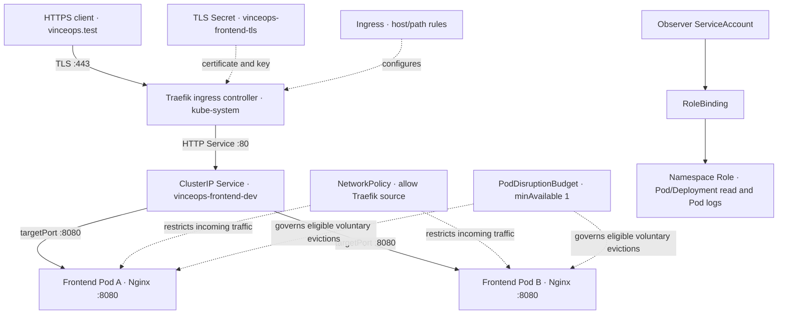

# Kubernetes Networking, Security & Operations

**VinceOps | Platform Engineering · Project 06**  
**Status:** Implemented and validated in a single-node K3s development cluster  
**Evidence captured:** 26 October 2026  
**Scope:** HTTPS ingress · Pod network isolation · namespace-scoped RBAC · voluntary disruption budgeting · operational verification

## Executive summary

VinceOps extended its existing **React/Nginx frontend delivery workload** with Kubernetes networking and security controls. A Traefik-managed Ingress routes `https://vinceops.test` to the frontend's internal ClusterIP Service. A lab TLS certificate enables verified encrypted client-to-ingress communication. A namespace-scoped NetworkPolicy restricts ingress to selected frontend Pods, an observer ServiceAccount receives read-only Kubernetes API permissions, and a PodDisruptionBudget controls supported voluntary eviction operations.

The deployment was verified on K3s **v1.36.5+k3s1**. The frontend remained **2/2 Ready**, the TLS request returned **HTTP/2 200** with the lab certificate supplied as a trust anchor, all five RBAC authorization checks matched the intended `yes/no` matrix, and the PodDisruptionBudget reported **one allowed disruption** with two healthy replicas. The post-policy probe could not connect directly to the frontend Service, while HTTPS through Traefik still returned **200**.

**Validation boundary:** The screenshots do **not** establish a successful pre-policy probe response, so the observed post-policy connection refusal is consistent with isolation but is not presented as a definitive causal proof of NetworkPolicy enforcement. The deployment is a **development lab**, not a claim of production-grade high availability, publicly trusted TLS or backend integration.

## Architecture



### Routing and trust boundaries

- **Ingress** stores the HTTP host/path routing intent; **Traefik** implements it.
- **Service** provides a stable, namespace-local endpoint to ready frontend Pods; clients are not pinned to Pod IP addresses.
- **TLS** terminates at Traefik for this exercise. Traefik-to-frontend traffic uses HTTP inside the cluster; this is **not end-to-end encryption**.
- **NetworkPolicy** restricts selected frontend Pod ingress to TCP `8080` from a matching Traefik Pod in `kube-system`; selector matching is evaluated before enforcement.
- **RBAC** restricts Kubernetes **API operations**, not HTTP network paths. It is independent of NetworkPolicy.
- **PDB** restricts eligible **voluntary eviction** operations, not node failures or arbitrary container crashes.

## Repository components

```text
05-Kubernetes/project-06-networking-security-operations/
├── manifests/
│   ├── frontend-ingress.yaml
│   ├── frontend-network-policy.yaml
│   ├── frontend-observer-rbac.yaml
│   └── frontend-pdb.yaml
├── screenshots/
│   ├── 01-tls-certificate-and-networkpolicy-preparation.png
│   ├── 02-six-resources-schema-validation.png
│   ├── 03-k3s-traefik-class-and-pod-labels.png
│   ├── 04-frontend-https-ingress-verification.png
│   ├── 05-networkpolicy-isolation-observation.png
│   ├── 06-rbac-authorisation-and-pdb.png
│   └── 07-pod-health-logs-and-events.png
└── README.md
```

The existing frontend image and deployment originate from [`../project-05-ci-cd/chart`](../project-05-ci-cd/chart), which is reused here without redesigning or recreating the application.

## Implementation and validation

### 1. Ingress and HTTPS

The Ingress declares `ingressClassName: traefik`, the lab hostname `vinceops.test`, TLS Secret `vinceops-frontend-tls`, and a backend Service `vinceops-frontend-dev` on port `80`. The Service targets container port `8080`.

A self-signed RSA certificate with `subjectAltName=DNS:vinceops.test` was generated **outside version control** and installed as a `kubernetes.io/tls` Secret in `vinceops-ci-dev`. Verification used a local name-to-IP mapping and explicit trust of the lab certificate:

```bash
TRAEFIK_IP=$(kubectl get svc traefik -n kube-system -o jsonpath='{.spec.clusterIP}')
TLS_DIR="$HOME/.config/vinceops-project06/tls"

curl --noproxy '*' \
  --resolve "vinceops.test:443:$TRAEFIK_IP" \
  --cacert "$TLS_DIR/tls.crt" \
  -i https://vinceops.test/healthz
```

**Observed:** `HTTP/2 200`, with the frontend's Nginx headers. The browser's normal certificate trust store would not trust this self-signed certificate; the test uses `--cacert` deliberately instead of disabling verification.

### 2. Pod network isolation

The `vinceops-frontend-allow-traefik` NetworkPolicy selects Pods with label `app=vinceops-frontend-dev` in namespace `vinceops-ci-dev`. The permitted source requires **both** namespace `kube-system` and Pod label `app.kubernetes.io/name=traefik`, to destination TCP port `8080`.

The Traefik Pod label was checked against the live cluster. An ordinary `vinceops-probe` Pod then attempted access through the frontend Service. **After** policy creation, the direct connection failed with `curl: (7) ... Connection refused`; a separate HTTPS request through Traefik still returned `200`. The temporary probe Pod was deleted after the test.

**Interpretation:** These observations are compatible with source-restricted access while retaining ingress availability. However, the preceding probe output did not show a confirmed baseline response or an exit-status capture. A stricter follow-up test would record both pre-policy and post-policy HTTP status/exit codes and exercise Pod-IP traffic as well as Service traffic, while checking network-policy-controller state. Do not treat a connection refusal in isolation as uniquely attributable to NetworkPolicy.

### 3. Namespace-scoped read-only RBAC

The `vinceops-observer` ServiceAccount is bound via `vinceops-observer-binding` to `vinceops-observer-role`. The Role grants `get/list/watch` for Pods and Deployments and `get` for the Pod-log subresource, but grants **no** write or Secret-reading permission.

Authorization was verified without revealing a ServiceAccount token:

```bash
OBSERVER="system:serviceaccount:vinceops-ci-dev:vinceops-observer"
kubectl auth can-i list pods --as="$OBSERVER" -n vinceops-ci-dev
kubectl auth can-i delete pods --as="$OBSERVER" -n vinceops-ci-dev
kubectl auth can-i get pods --subresource=log --as="$OBSERVER" -n vinceops-ci-dev
kubectl auth can-i get secrets --as="$OBSERVER" -n vinceops-ci-dev
kubectl auth can-i list deployments.apps --as="$OBSERVER" -n vinceops-ci-dev
```

| Requested action | Observed authorization |
|---|---|
| List Pods | `yes` |
| Delete Pods | `no` |
| Read Pod logs | `yes` |
| Read Secrets | `no` |
| List Deployments | `yes` |

This is a namespace-scoped permission check of the configured observer identity; additional RoleBindings could change effective permissions in other contexts.

### 4. PodDisruptionBudget and reliability

`vinceops-frontend-pdb` selects the two frontend Pods using `app=vinceops-frontend-dev` and requests `minAvailable: 1`.

| PDB field | Observed |
|---|---:|
| Current healthy | 2 |
| Desired healthy | 1 |
| Total selected | 2 |
| Allowed disruptions | 1 |

The cluster used one node. The PDB result is evidence of **configured voluntary eviction control**, not node-failure tolerance or multi-node availability. No deliberate node drain or eviction was performed.

### 5. Operational diagnostics

- `kubectl get pods -n vinceops-ci-dev -o wide` displayed **2/2 Pods Ready**, both `Running`, with zero restarts.
- `kubectl logs deployment/vinceops-frontend-dev -n vinceops-ci-dev --tail=20` showed Nginx startup and worker-process initialization. A read-only default configuration message appeared, but did not stop startup.
- `kubectl get events -n vinceops-ci-dev --sort-by=.lastTimestamp` showed normal scheduling, image pull, container creation and startup events, plus the deliberate probe deletion.

### 6. Static manifest checks

The manifests contain **six resources across four YAML files**. Kubeconform strict schema validation reported:

```text
Summary: 6 resources found in 4 files - Valid: 6, Invalid: 0, Errors: 0, Skipped: 0
```

Schema success is a prerequisite; it does **not** establish runtime connectivity, authentication, policy effectiveness or operational readiness on its own.

## Evidence index

| Evidence | Claim supported |
|---|---|
| [01 · TLS certificate and policy preparation](screenshots/01-tls-certificate-and-networkpolicy-preparation.png) | Lab SAN/validity inspection, initial schema validation and policy manifest |
| [02 · Six-resource schema validation](screenshots/02-six-resources-schema-validation.png) | Strict schema results: 6 valid, 0 invalid |
| [03 · K3s and Traefik readiness](screenshots/03-k3s-traefik-class-and-pod-labels.png) | Ready node, default Traefik IngressClass and Pod label match |
| [04 · HTTPS ingress verification](screenshots/04-frontend-https-ingress-verification.png) | TLS Secret and Ingress, ready Pods, and HTTPS 200 using `--cacert` |
| [05 · NetworkPolicy observation](screenshots/05-networkpolicy-isolation-observation.png) | Post-policy direct connection refusal with continued HTTPS 200 |
| [06 · RBAC and PDB](screenshots/06-rbac-authorisation-and-pdb.png) | Five `can-i` answers and PDB healthy/allowed counts |
| [07 · Operations](screenshots/07-pod-health-logs-and-events.png) | Running Pod state, Nginx logs and workload events |

These are original terminal evidence captures from the implementation. Screenshots document the observed tests, not an unverified production certification.

## Design choices and current limitations

| Area | Implemented | Not demonstrated / next improvement |
|---|---|---|
| Ingress | Host-based routing via Traefik | Public DNS, internet exposure and HTTPS redirect policy |
| TLS | Local self-signed certificate with explicit client trust | Publicly trusted certificate issuance and automatic rotation |
| Frontend | Two React/Nginx Pods, probes and ClusterIP Service | Spring Boot movie API and its upstream routing |
| NetworkPolicy | Selected frontend ingress from Traefik | A conclusive captured before/after enforcement matrix and negative test across network paths |
| RBAC | Read-only observer identity, validated API permissions | Broader identity lifecycle, audit logging and operational access review |
| PDB | `minAvailable: 1`, one eligible disruption | Multi-node scheduling, node-failure tolerance and actual eviction exercise |
| Observability | Pod readiness, startup logs, Kubernetes events | Metrics aggregation, alerting and distributed tracing |

## Outcomes

VinceOps now has a documented baseline for **HTTP routing, TLS termination, namespace-scoped network isolation intent, least-privilege Kubernetes API access, voluntary eviction budgeting and incident-oriented diagnostics**. The design deliberately reuses the existing Project 05 frontend application to connect delivery, networking and security into one coherent platform engineering portfolio.
