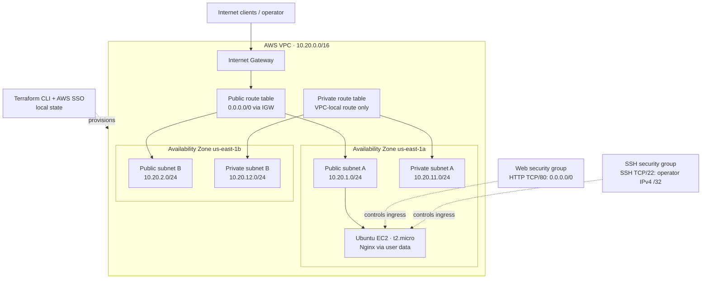

# AWS Network and EC2 Provisioning with Terraform

**VinceOps · Infrastructure as Code · AWS `us-east-1` · Completed laboratory implementation**

## Project summary

This project demonstrates the end-to-end management of an AWS environment using Terraform: declarative network provisioning, a public Ubuntu EC2 web server, automated Nginx configuration, connectivity verification, state reconciliation, an in-place infrastructure change, and controlled teardown.

The environment was deployed and tested in the VinceOps development account. It was intentionally temporary; the final Terraform operation removed all 17 managed resources. The evidence below records the observed deployment, not an always-running service.

### Verified outcomes

| Verification | Observed result | Evidence |
|---|---|---|
| Initial network provisioning | **13 resources created** | [Network validation](./docs/evidence/validation/01-networking-validation.md) |
| Public/private subnet layout | Four subnets across `us-east-1a` and `us-east-1b`; routes confirmed via AWS CLI | [Network validation](./docs/evidence/validation/01-networking-validation.md) |
| EC2 and automated web service | Ubuntu 24.04, `t2.micro`, Nginx active, cloud-init complete | [EC2 validation](./docs/evidence/validation/02-ec2-validation.md) |
| Application availability | SSH successful; local and public HTTP returned **200 OK** | [EC2 validation](./docs/evidence/validation/02-ec2-validation.md) |
| Idempotency | Subsequent plan reported **No changes** | [Idempotency record](./docs/evidence/validation/03-terraform-idempotency.md) |
| Controlled change | EC2 tag updated **in place**: 0 added, 1 changed, 0 destroyed | [Lifecycle record](./docs/evidence/validation/04-terraform-lifecycle.md) |
| Teardown | **17 managed resources destroyed**; state list empty | [Cleanup record](./docs/evidence/validation/05-resource-cleanup.md) |

## Implemented architecture



The EC2 instance ran in the **first public subnet only**; the second public subnet and both private subnets were provisioned as network foundations, not as populated application tiers. Private subnet routing had **no NAT Gateway or internet default route**. The `kubernetes.io/role/*` subnet tags document future load-balancer discovery intent; they do not mean that Kubernetes or EKS was deployed in this project.

## Infrastructure and implementation

| Layer | Configuration | Source |
|---|---|---|
| Network | VPC `10.20.0.0/16`; two public and two private `/24` subnets; Internet Gateway; route tables and associations | [`main.tf`](./main.tf) |
| Workload access | TCP 80 public ingress; TCP 22 allowed from one supplied operator IP (`/32`); outbound permitted | [`security.tf`](./security.tf), [`compute.tf`](./compute.tf) |
| Compute | Ubuntu 24.04 LTS AMI; `t2.micro`; 8 GiB encrypted gp3 root volume; public IPv4; ED25519 public-key registration | [`compute.tf`](./compute.tf) |
| Bootstrap | EC2 user data installed and enabled Nginx and published a custom HTML landing page | [`compute.tf`](./compute.tf) |
| Inputs and outputs | Region/profile, CIDR ranges, restricted SSH CIDR, VPC/subnet/route-table IDs and EC2 connection information | [`variables.tf`](./variables.tf), [`outputs.tf`](./outputs.tf), [`compute.tf`](./compute.tf) |
| Toolchain | Terraform `>= 1.5`, AWS provider `~> 5.0`; provider version locked in repository | [`versions.tf`](./versions.tf), [`.terraform.lock.hcl`](./.terraform.lock.hcl) |

### Engineering decisions and trade-offs

- **Separation of network tiers.** Public subnets use a default route to the Internet Gateway; private subnets retain local routing only. No private outbound internet access was provisioned.
- **Restrained administrative exposure.** SSH ingress was limited to the operator's observed public IP instead of exposing port 22 to the entire internet. This CIDR must be updated when the operator's IP changes.
- **Automated configuration.** Nginx installation and initial site content were defined as EC2 user data, reducing manual post-provisioning setup.
- **Reconciliation before teardown.** A second plan showed no drift. The EC2 `Validation` tag was then updated without replacement, followed by a no-change plan and full destroy.
- **Local state for an individual lab.** Terraform state was held locally and excluded from version control. This implementation did **not** demonstrate an S3 backend, state locking, Terraform modules, EKS provisioning, high availability or production-grade monitoring.
- **Environment-specific configuration.** The named AWS SSO profile and SSH public-key path identify this specific lab. They are not portable defaults for an arbitrary AWS account.

## Source layout

```text
terraform-networking-lab/
├── main.tf                 # VPC, subnets, routing, tagging
├── security.tf             # Public HTTP security group
├── compute.tf              # AMI lookup, key pair, SSH group, EC2, Nginx bootstrap
├── variables.tf            # Configurable lab inputs
├── outputs.tf              # Network outputs
├── versions.tf             # Terraform and AWS provider constraints
├── .terraform.lock.hcl     # Provider version lock
├── .gitignore              # Excludes local state, plans and variable files
└── docs/
    ├── operations.md       # Separate reproduction and teardown reference
    └── evidence/
        ├── validation/     # Five test and lifecycle records
        └── screenshots/    # Twelve original screenshots and an evidence index
```

## Evidence and review path

1. **Network topology and routes:** [network validation](./docs/evidence/validation/01-networking-validation.md), including the [subnet](./docs/evidence/screenshots/02-public-private-subnets-aws-cli.png) and [route-table](./docs/evidence/screenshots/03-route-tables-aws-cli.png) outputs.
2. **EC2, cloud-init and HTTP:** [EC2 validation](./docs/evidence/validation/02-ec2-validation.md) and [HTTP / SSH evidence](./docs/evidence/screenshots/05-remote-ssh-and-public-http.png).
3. **State reconciliation and change control:** [idempotency](./docs/evidence/validation/03-terraform-idempotency.md) and [in-place update](./docs/evidence/validation/04-terraform-lifecycle.md).
4. **Resource lifecycle and final state:** [teardown evidence](./docs/evidence/validation/05-resource-cleanup.md) and [successful destroy screenshot](./docs/evidence/screenshots/11-terraform-destroy-success.png).

[Browse all twelve screenshots](./docs/evidence/screenshots/README.md) · [Operations reference](./docs/operations.md) · [Phase 06 overview](../README.md)

## Result and scope

**Completed:** The network, compute workload and Nginx application were deployed and validated, a controlled change was applied without replacing the instance, and Terraform subsequently destroyed all 17 lab-managed resources. Screenshots document tests performed at the time; the public IP address in historical evidence is not a live project endpoint.

This is a single-instance AWS infrastructure lab, not a production deployment or an implemented EKS cluster.
