# VinceOps Terraform — Original Screenshot Evidence

These are original screenshots provided during the AWS Terraform lab. The image pixels are preserved without edits or fabricated results.
They show historical lab results, **not an always-running public service**. Resources were later destroyed.

| File | What it demonstrates | Related validation notes |
|---|---|---|
| [01-networking-terraform-apply.png](./01-networking-terraform-apply.png) | Initial Terraform networking apply: 13 resources created. | [Evidence record](../01-networking-validation.md) |
| [02-public-private-subnets-aws-cli.png](./02-public-private-subnets-aws-cli.png) | AWS CLI verification of the four subnets and public IP auto-assignment. | [Evidence record](../01-networking-validation.md) |
| [03-route-tables-aws-cli.png](./03-route-tables-aws-cli.png) | AWS CLI verification of public Internet Gateway route and private local-only route. | [Evidence record](../01-networking-validation.md) |
| [04-ec2-keypair-deployment-success.png](./04-ec2-keypair-deployment-success.png) | Terraform apply for the key pair and Ubuntu EC2 instance: 2 resources added. | [Evidence record](../02-ec2-validation.md) |
| [05-remote-ssh-and-public-http.png](./05-remote-ssh-and-public-http.png) | SSH connection to the Ubuntu instance and successful public HTTP response. | [Evidence record](../02-ec2-validation.md) |
| [06-cloud-init-nginx-local-http.png](./06-cloud-init-nginx-local-http.png) | Cloud-init completed, nginx active, local HTTP 200 and custom page content. | [Evidence record](../02-ec2-validation.md) |
| [07-terraform-idempotency.png](./07-terraform-idempotency.png) | Terraform plan reports no changes after deployment. | [Evidence record](../03-terraform-idempotency.md) |
| [08-in-place-tag-update-plan.png](./08-in-place-tag-update-plan.png) | Terraform plan for the controlled EC2 tag update: 0 add, 1 change, 0 destroy. | [Evidence record](../04-terraform-lifecycle.md) |
| [09-tag-update-applied-no-drift.png](./09-tag-update-applied-no-drift.png) | Terraform apply of the tag and subsequent no-change verification. | [Evidence record](../04-terraform-lifecycle.md) |
| [10-terraform-destroy-plan.png](./10-terraform-destroy-plan.png) | Terraform destroy command and planned removal of resources. | [Evidence record](../05-resource-cleanup.md) |
| [11-terraform-destroy-success.png](./11-terraform-destroy-success.png) | Final destruction output: 17 resources destroyed. | [Evidence record](../05-resource-cleanup.md) |
| [12-empty-state-and-git-ignore.png](./12-empty-state-and-git-ignore.png) | Empty Terraform managed-resource state and Git ignore checks for local state and plan files. | [Evidence record](../05-resource-cleanup.md) |

## Visual evidence

### 01-networking-terraform-apply.png
Initial Terraform networking apply: 13 resources created.

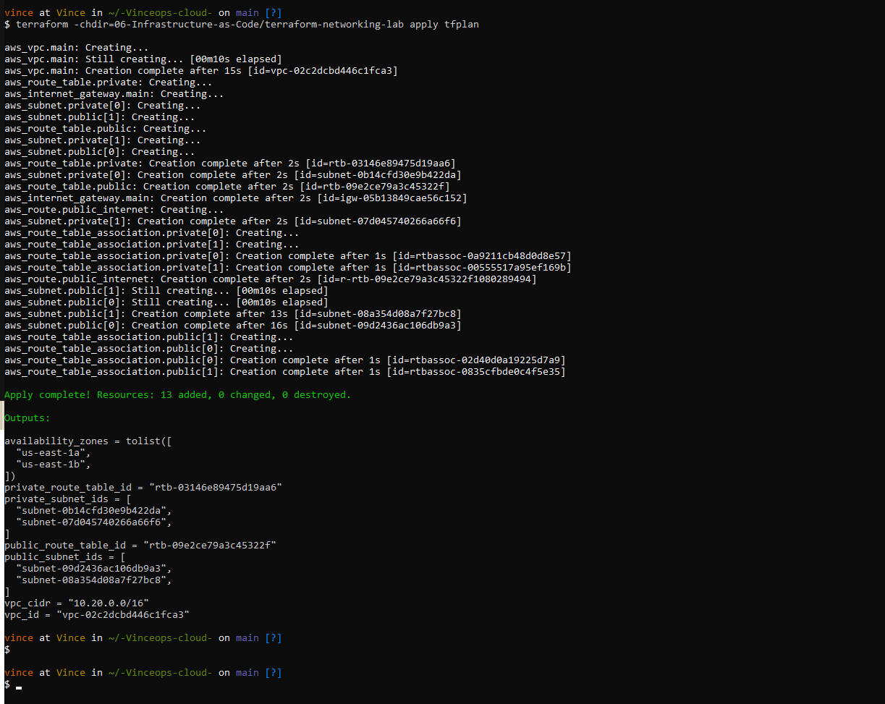

### 02-public-private-subnets-aws-cli.png
AWS CLI verification of the four subnets and public IP auto-assignment.

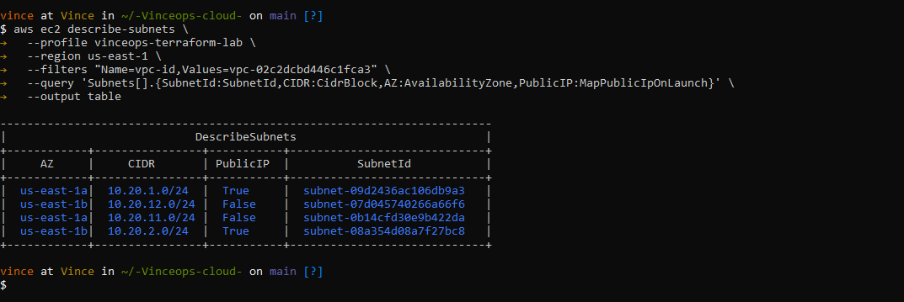

### 03-route-tables-aws-cli.png
AWS CLI verification of public Internet Gateway route and private local-only route.

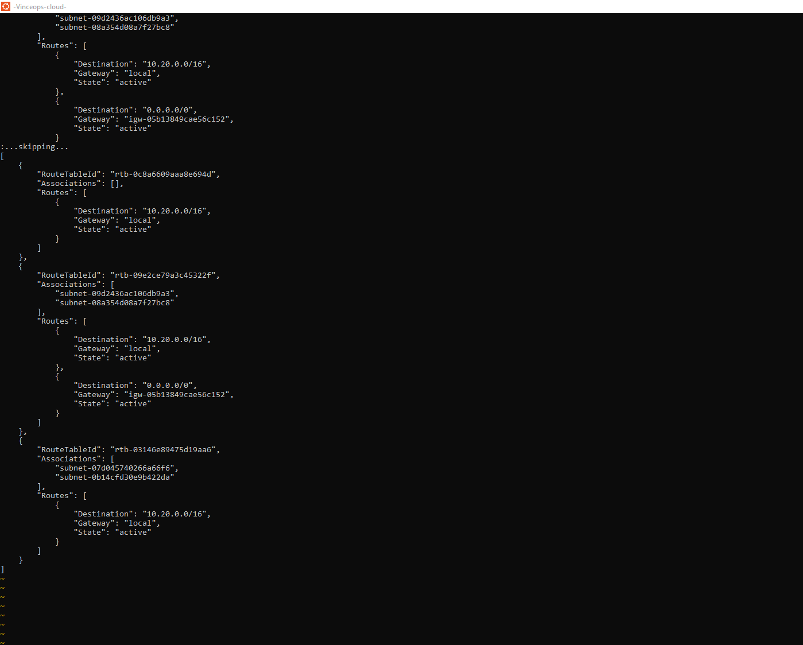

### 04-ec2-keypair-deployment-success.png
Terraform apply for the key pair and Ubuntu EC2 instance: 2 resources added.

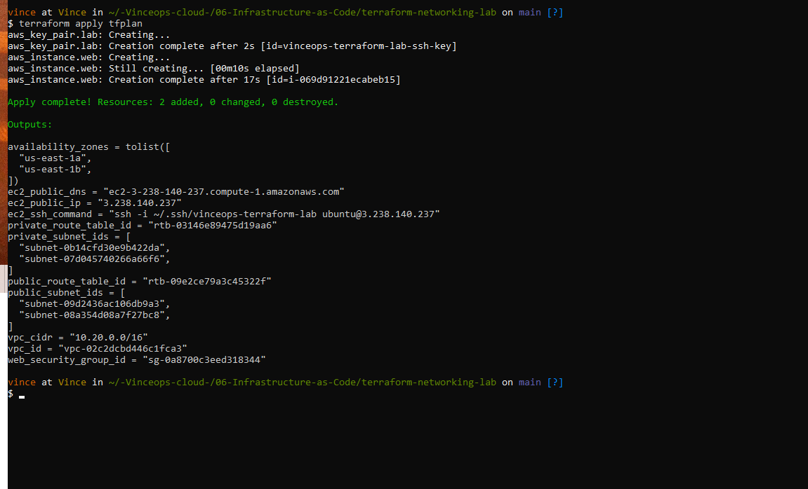

### 05-remote-ssh-and-public-http.png
SSH connection to the Ubuntu instance and successful public HTTP response.

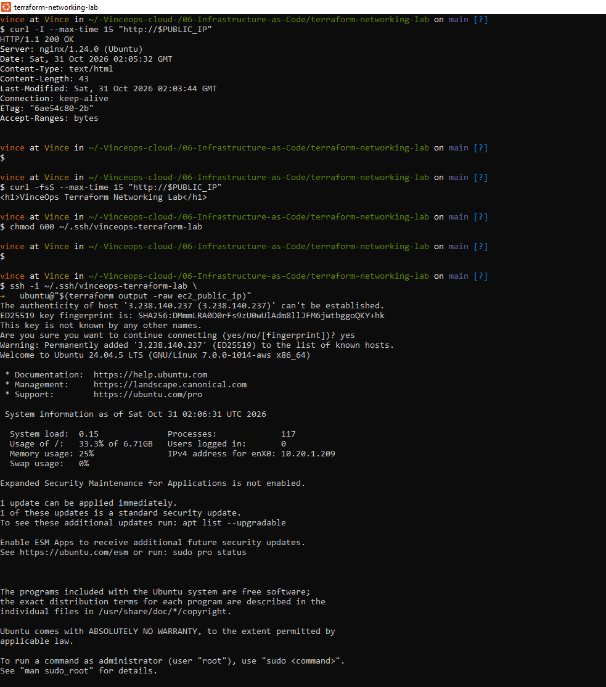

### 06-cloud-init-nginx-local-http.png
Cloud-init completed, nginx active, local HTTP 200 and custom page content.

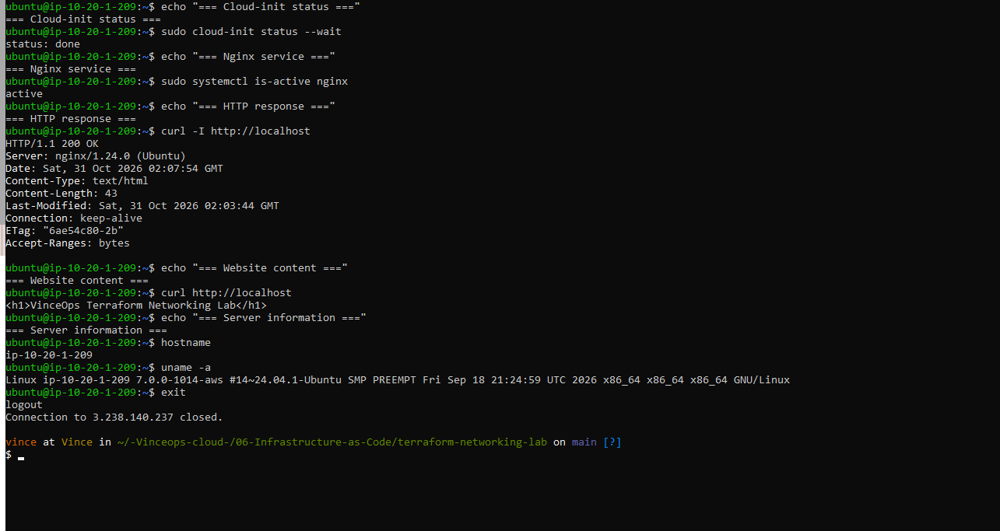

### 07-terraform-idempotency.png
Terraform plan reports no changes after deployment.

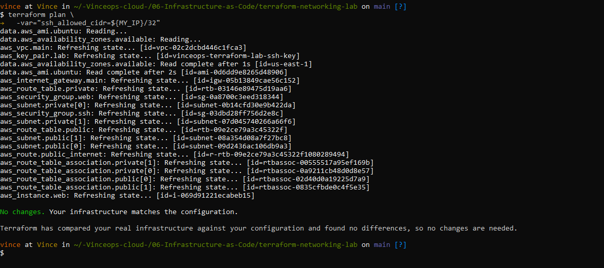

### 08-in-place-tag-update-plan.png
Terraform plan for the controlled EC2 tag update: 0 add, 1 change, 0 destroy.

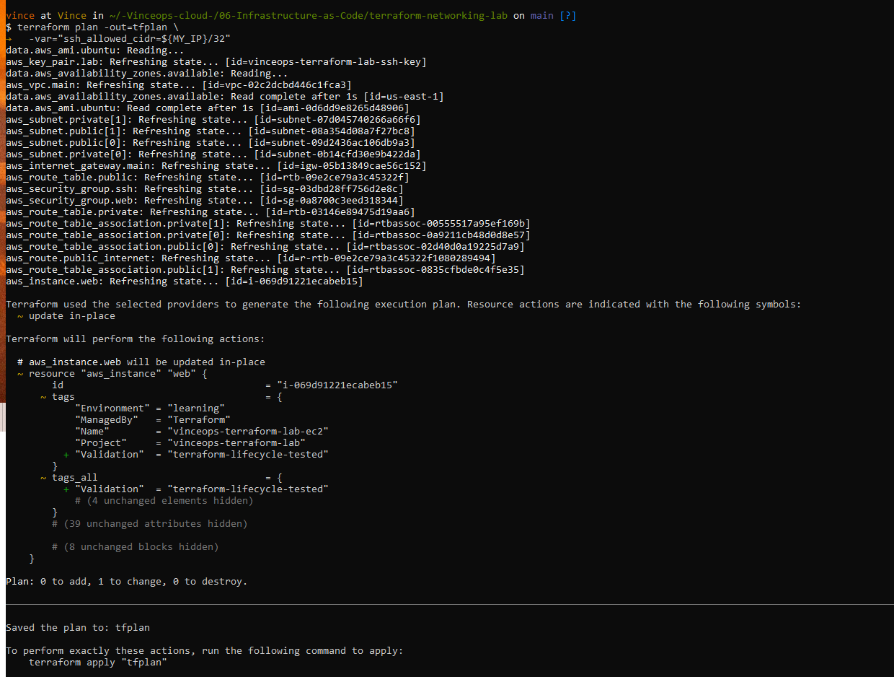

### 09-tag-update-applied-no-drift.png
Terraform apply of the tag and subsequent no-change verification.

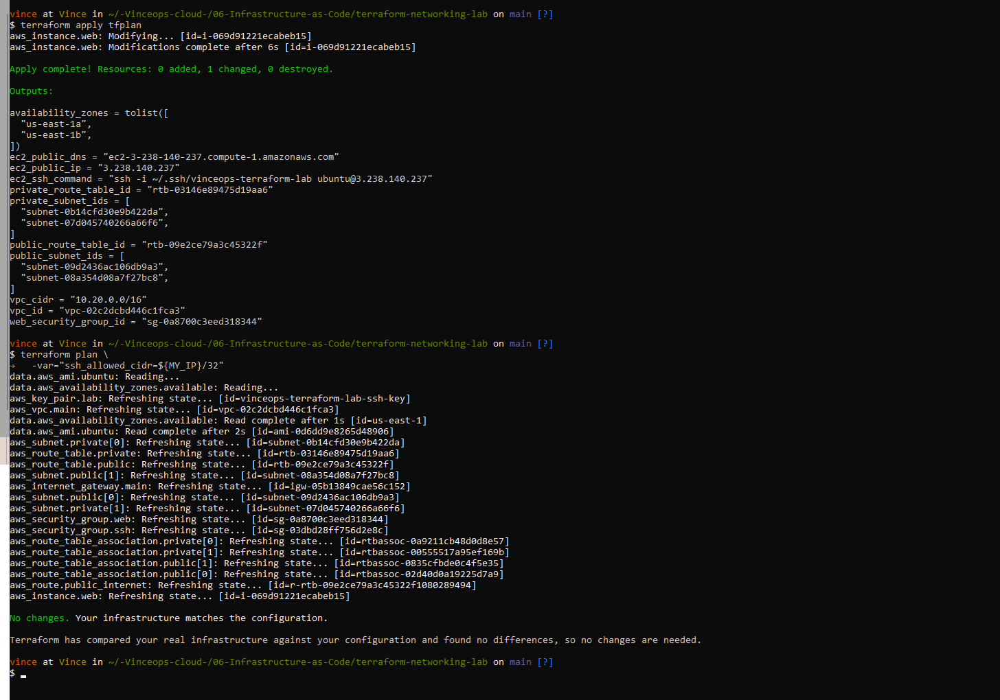

### 10-terraform-destroy-plan.png
Terraform destroy command and planned removal of resources.

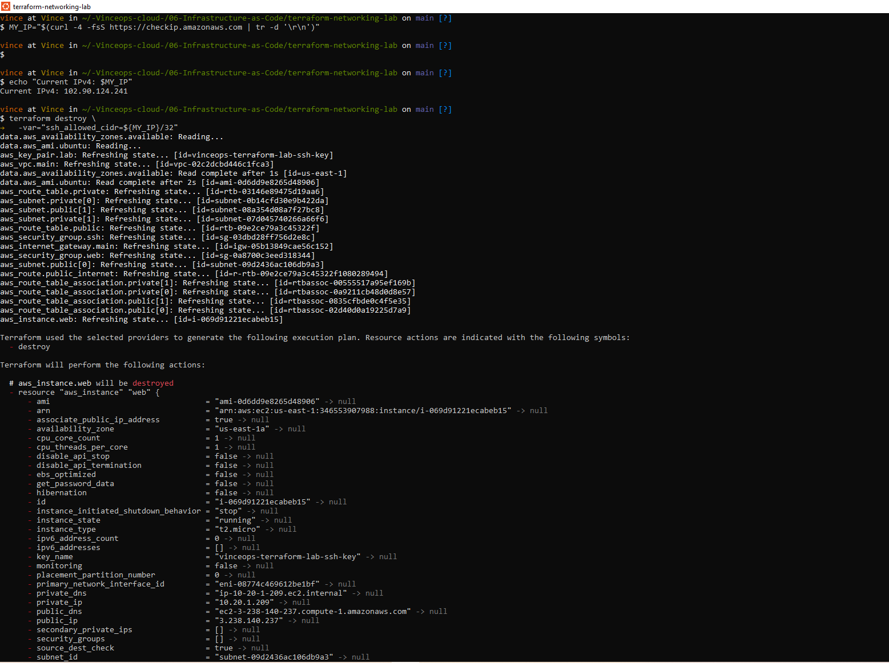

### 11-terraform-destroy-success.png
Final destruction output: 17 resources destroyed.

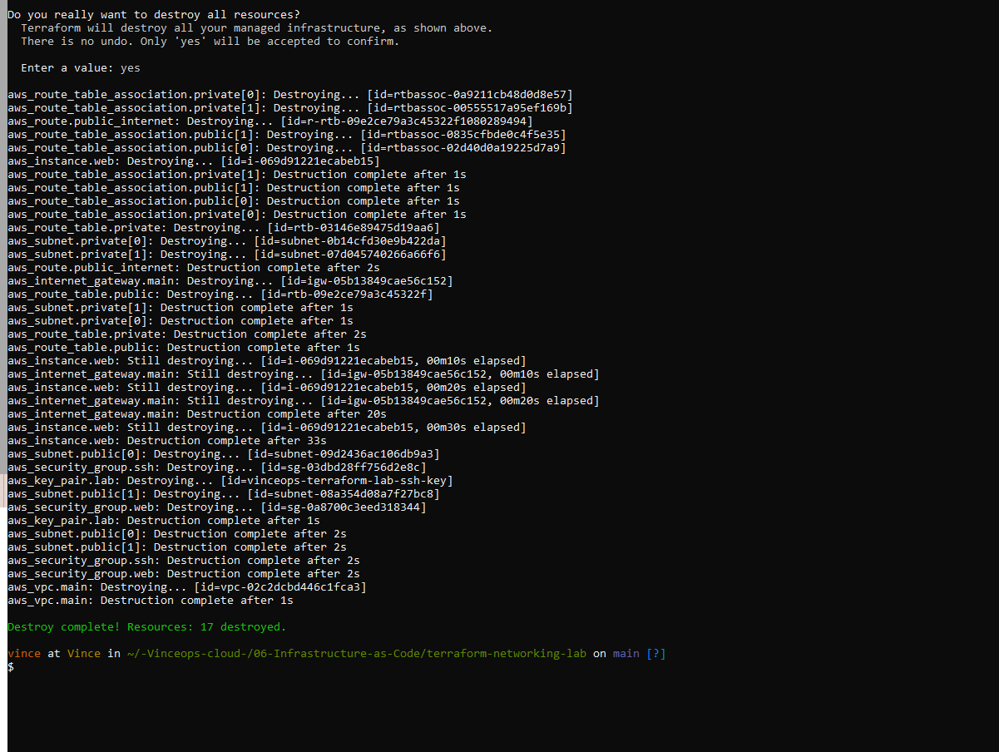

### 12-empty-state-and-git-ignore.png
Empty Terraform managed-resource state and Git ignore checks for local state and plan files.

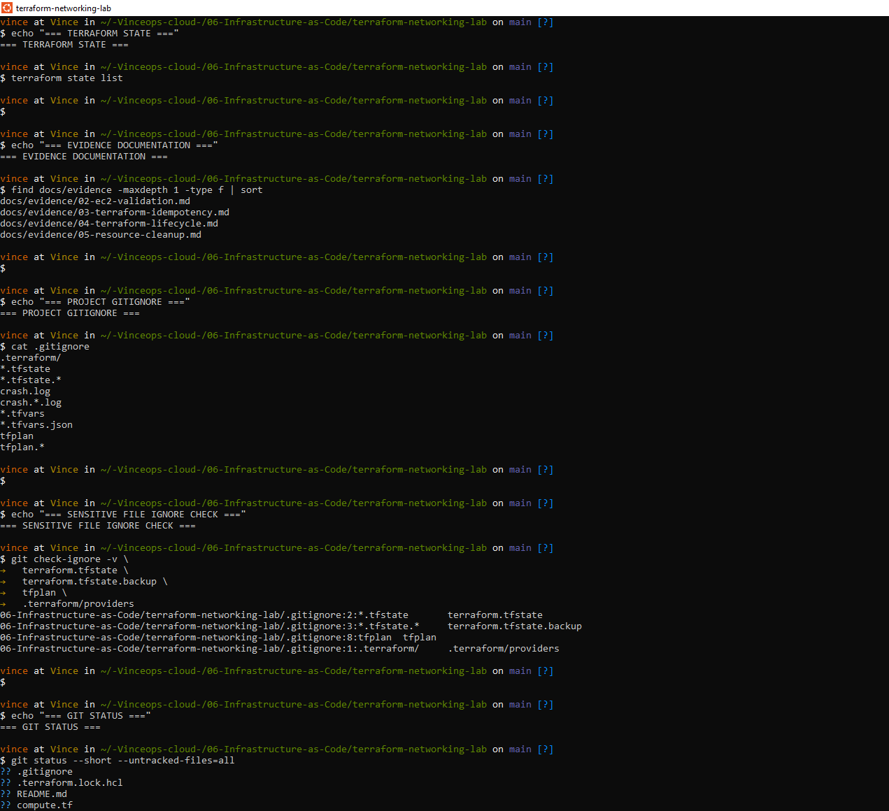

## Integrity and scope

- Screenshots preserve original terminal results; some include historical AWS resource IDs and the then-public EC2 IP address.
- Do not represent a destroyed resource as currently running or a historical public URL as currently accessible.
- No active IAM authentication flows, access codes, credentials, private keys or Terraform state files are included.
- No screenshot of a browser rendering the website was provided; public HTTP response and SSH evidence are included instead.
