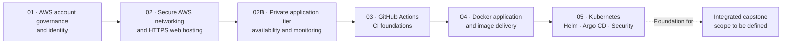

# VinceOps | Cloud, Security & Platform Engineering

**An evidence-led cloud engineering portfolio built around a simulated fintech organization.**

VinceOps documents the progressive design, deployment, security and operation of AWS infrastructure and cloud-native applications. The work begins with **multi-account governance and workforce identity**, moves through **secure networking and resilient application hosting**, and develops into **continuous integration, containerization, Kubernetes and GitOps delivery**.

The repository is organized as a series of hands-on engineering milestones. Each phase contains its own documentation, configurations, architecture decisions, troubleshooting records and implementation evidence. **These are verified lab implementations and project demonstrations—not a claim that every component operates together today as one continuously running production system.**

## At a glance

| Engineering area | What VinceOps has demonstrated |
|---|---|
| **Cloud governance and identity** | Four-account AWS Organization; separation of management, development, staging and production; IAM Identity Center groups and permission-set assignments |
| **AWS networking and security** | Custom VPC, subnet and route design, Internet Gateway, security groups and NACLs, controlled SSH access, DNS, HTTPS, VPC Flow Logs and external exposure checks |
| **Private infrastructure and resilience** | Two-AZ public/private networking, NAT-based egress, private EC2 application tier, ALB and health checks, Launch Templates, Auto Scaling lab design, and EFS shared storage |
| **Monitoring and response** | Infrastructure visibility and alert-delivery exercises using Datadog and Slack, supported by recorded evidence |
| **CI and source-control automation** | GitHub Actions workflows, validation, troubleshooting, container-build tests and recorded pipeline results |
| **Application containerization** | React frontend, Spring Boot API and MongoDB packaged for a Docker/EC2 lab; image publishing to Amazon ECR |
| **Kubernetes and GitOps** | K3s, Deployments, Services, ConfigMaps, Helm, Argo CD, GHCR promotion, HTTPS Ingress, NetworkPolicy, RBAC, PDB and operational validation |

## Explore the engineering milestones

| Phase | Project | Focus | Documentation |
|---|---|---|---|
| **01** | **AWS Cloud Foundation & Identity** | Account boundaries, IAM Identity Center, role/group-based access and governance decisions | [Cloud Foundation](./01-Cloud-Foundation/README.md) |
| **02** | **AWS Networking & Secure Web Delivery** | Public VPC networking, EC2/Nginx hosting, DNS, Let's Encrypt HTTPS, flow logging and security testing | [Networking & Security](./02-Networking-Security/README.md) |
| **02B** | **Private Infrastructure & Security Validation** | Multi-AZ segmentation, NAT, private compute, ALB, EFS, scaling patterns, monitoring and incident evidence | [Infrastructure Validation](./02B-Security-Validation/README.MD) |
| **03** | **CI Foundations** | GitHub Actions workflow setup, repository checks, execution evidence and troubleshooting | [CI Foundations](./03-CI-CD-Pipeline/README.md) |
| **04** | **Containerized Application Delivery** | Dockerized React, Spring Boot and MongoDB application, EC2 testing and ECR artifacts | [Containerization](./04-Containerization/README.md) |
| **05** | **Kubernetes Platform Engineering** | Six connected projects, progressing from workload orchestration to GitOps, ingress and runtime security | [Kubernetes Engineering](./05-Kubernetes/README.md) |
| **06** | **Terraform Infrastructure as Code** | AWS VPC, multi-AZ subnets, EC2, IAM, validation, updates and teardown | [Terraform IaC](./06-Infrastructure-as-Code/README.md) |

**Next milestone — Integrated VinceOps Capstone.** The capstone will be defined after the repository cleanup. It is intended to bring the platform disciplines together, including Terraform-based infrastructure automation and observability, rather than treating these as separate stand-alone project tracks. No capstone implementation is claimed here yet.

## How the platform evolved

This diagram shows the **learning and engineering progression** of the repository. Individual phases were often built and verified in separate AWS or Kubernetes lab environments; the diagram does not imply an existing persistent connection between all systems.

## 01 — Establishing secure AWS governance

The platform started by defining **where workloads belong and who can access each environment**, before creating application infrastructure.

- Created an AWS Organization with separate **Management, Development, Staging and Production** accounts.
- Configured **AWS IAM Identity Center** for centralized workforce identity and access.
- Designed five workforce groups, permission-set baselines and account-specific assignments.
- Restricted Development, Staging and governance access by role; the documented model grants **no direct standing IAM Identity Center assignment to Production**.
- Recorded decisions concerning account separation, access boundaries and conservative permission baselines.

**Explore:** [Cloud Foundation README](./01-Cloud-Foundation/README.md) · [IAM architecture and decisions](./01-Cloud-Foundation/decisions.md) · [AWS account evidence](./01-Cloud-Foundation/screenshots/Read.md)

## 02 — Building and securing internet-facing infrastructure

The next phase turned the AWS foundation into a functioning web-hosting environment, with networking and security designed explicitly rather than left to default settings.

- Built a **custom VPC** with a public subnet, Internet Gateway and route-table configuration.
- Configured **security-group and Network ACL** controls and SSH key-based server administration.
- Deployed **Ubuntu on EC2** and served a website using **Nginx**.
- Configured the `vinceops.site` domain and **HTTPS using Let's Encrypt / Certbot**.
- Collected **VPC Flow Logs to Amazon S3** and performed external port/exposure checks.
- Kept configuration, architecture diagrams and deployment/security-verification evidence with the project.

**Explore:** [Networking & Security README](./02-Networking-Security/README.md) · [Architecture diagram](./02-Networking-Security/diagrams/network-web-architecture.png)

## 02B — Strengthening availability, isolation and operational visibility

The infrastructure was then extended beyond a single publicly exposed EC2 host into a **segmented AWS application architecture**.

- Implemented **public and private subnet tiers across two Availability Zones**, with NAT-based egress for private workloads.
- Tested **ALB-backed web delivery**, target health and layered ingress/security-group boundaries.
- Documented **private EC2 application compute**, Launch Templates and Auto Scaling configuration concepts.
- Introduced **Amazon EFS** mount targets, access-point configuration and shared application content.
- Tested HTTPS listener behavior and captured operational troubleshooting evidence.
- Documented **Datadog monitoring and Slack notifications**, including threshold and recovery evidence.

**Explore:** [Phase 02B README](./02B-Security-Validation/README.MD) · [Architecture](./02B-Security-Validation/architecture/vinceops-month-2b-architecture.png) · [Evidence by engineering layer](./02B-Security-Validation/evidence/README.md)

## 03–04 — Moving from infrastructure to application delivery

**Continuous integration foundations** introduced GitHub Actions as an auditable way to validate repository changes. The phase records workflow setup and troubleshooting, while the later Kubernetes projects demonstrate the fuller build-and-delivery automation.

**Containerization** packaged a movie application into separate layers: a **React frontend**, **Spring Boot backend API** and **MongoDB**. The project includes Docker packaging, EC2 deployment/testing and Amazon ECR publication evidence. The original application's source provenance is discussed in the containerization documentation.

**Explore:** [CI Foundations](./03-CI-CD-Pipeline/README.md) · [Containerization](./04-Containerization/README.md) · [Deployment evidence](./04-Containerization/docs/screenshots/)

## 05 — Developing the Kubernetes engineering platform

The Kubernetes workstream comprises **six completed labs**, documented individually rather than compressed into one root-level tutorial:

| Project | Demonstrated capability |
|---|---|
| [01 — Fundamentals](./05-Kubernetes/project-01-kubernetes-fundamentals/README.md) | K3s, Nginx Deployments, Services, scaling, Pod replacement and desired-state recovery |
| [02 — Declarative configuration](./05-Kubernetes/project-02-declarative-configuration/README.md) | Namespaces, ConfigMap-mounted content, live updates and rollback |
| [03 — Helm](./05-Kubernetes/project-03-helm/README.md) | Reusable chart, templating, upgrades, rollbacks and CI checks |
| [04 — Argo CD GitOps](./05-Kubernetes/project-04-argocd-gitops/README.md) | Git-backed application reconciliation and drift correction |
| [05 — Frontend CI/CD](./05-Kubernetes/project-05-ci-cd/README.md) | React build, Docker test, GHCR publishing, automated image-tag promotion and Kubernetes rollout |
| [06 — Networking, security & operations](./05-Kubernetes/project-06-networking-security-operations/README.md) | Traefik HTTPS Ingress, NetworkPolicy testing, read-only RBAC, PodDisruptionBudget and diagnostics |

The frontend CI/CD demonstration reached **Argo CD Synced / Healthy** with two ready replicas and a new commit-tagged container image. This does not mean the complete movie backend and database were migrated into that same Kubernetes lab; those boundaries are described in the individual READMEs.

**Explore:** [Kubernetes workstream overview](./05-Kubernetes/README.md) · [Kubernetes evidence and code](./05-Kubernetes/)

## Security, reliability and engineering practices

Security and operations are present throughout the portfolio—not isolated to the final Kubernetes project.

- **Identity:** AWS account separation, IAM Identity Center groups and permission sets, service-account RBAC.
- **Network protection:** VPC segmentation, security groups, NACLs, restricted administration, controlled application ingress and NetworkPolicy rules.
- **Transport security:** Public-site certificates in the AWS networking milestone and certificate-backed Traefik HTTPS in a Kubernetes lab.
- **Availability patterns:** Multi-AZ AWS network design, ALB health checks, EFS, EC2 scaling models and Kubernetes replicas/PDB behavior.
- **Observability:** VPC Flow Logs, infrastructure monitoring, Slack alerts, deployment events, Pod logs and health endpoints.
- **Change control:** Git history, declarative YAML, Helm upgrades/rollbacks, GitHub Actions and Argo CD reconciliation.
- **Verification:** Architecture records, configuration files, workflow runs, terminal results, screenshots and documented limitations.

## How to review the evidence

Start with any [project README](#explore-the-engineering-milestones), then follow its links to architecture diagrams, source configuration, verification records and screenshots. For a cross-section of the evidence:

| Area | Direct evidence |
|---|---|
| AWS organization and IAM | [Account and identity screenshots](./01-Cloud-Foundation/screenshots/Read.md) |
| Network deployment and HTTPS | [Phase 02 README and validation](./02-Networking-Security/README.md) |
| Private AWS architecture and monitoring | [Phase 02B evidence register](./02B-Security-Validation/evidence/README.md) |
| CI introduction | [Workflow success](./03-CI-CD-Pipeline/screenshots/workflow-success.png) |
| Docker and application delivery | [Containerization evidence gallery](./04-Containerization/docs/screenshots/) |
| Kubernetes delivery | [Projects 01–06](./05-Kubernetes/README.md) |
| GitHub Actions automation | [Repository workflows](./.github/workflows/) |

Lab infrastructure was often terminated after testing. Historical screenshots therefore document **observed results at the time of validation**, not necessarily services that remain accessible now. The Project 06 NetworkPolicy result is documented with its test limitations; schema validity alone is not treated as proof of enforcement.

---

*VinceOps is a simulated engineering organization and portfolio environment, not a commercial financial service or an always-on production deployment.*
