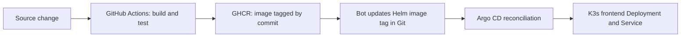

# VinceOps | Cloud & Platform Engineering

> An evidence-led AWS and DevOps engineering portfolio built around a **simulated fintech company**. Each project documents a business problem, its implementation, validation evidence, engineering decisions, and known limits.

VinceOps is a progressively developed cloud platform, from multi-account foundations and secure networks to containerized workloads, Kubernetes and GitOps delivery. The implementations were performed in controlled lab environments; the repository is **not** presented as a continuously operated production financial service.

## Explore the platform

| Workstream | Engineering outcome | Status | Documentation |
|---|---|---|---|
| 01 · Cloud Foundation | AWS Organizations, IAM Identity Center, account and workforce-access boundaries | Implemented and documented | [Explore](./01-Cloud-Foundation/) |
| 02 · Networking & Security | Custom VPC, EC2 web host, Nginx, DNS, HTTPS, flow logs and exposure review | Implemented and documented | [Explore](./02-Networking-Security/) |
| 02B · Security Validation | Multi-AZ/private-tier design, ALB, EFS, Auto Scaling and operational evidence | Implemented and documented | [Explore](./02B-Security-Validation/) |
| 03 · CI Foundations | GitHub Actions workflow concepts and initial automated checks | Implemented and documented | [Explore](./03-CI-CD-Pipeline/) |
| 04 · Containerization | React + Spring Boot + MongoDB application packaged and tested with Docker and AWS ECR | Lab implementation documented | [Explore](./04-Containerization/) |
| 05 · Kubernetes Platform | Six labs: fundamentals, ConfigMaps, Helm, Argo CD, CI/CD delivery, networking and security | **All six labs completed and documented** | [Explore](./05-Kubernetes/) |
| 06 · Infrastructure as Code | Terraform infrastructure provisioning and state management | **Planned; not yet implemented in this directory** | [Roadmap](./06-Infrastructure-as-Code/) |
| 07 · Observability & Security | Dedicated monitoring and DevSecOps platform | **Planned; no dedicated implementation in this directory** | [Roadmap folder](./07-Observability-Security/) |

> Some monitoring and alerting exercises were completed in **02B**; this is distinct from claiming the planned dedicated Phase 07 platform is deployed.

## Kubernetes engineering track

| Project | Capability | Evidence |
|---|---|---|
| [01 — Fundamentals](./05-Kubernetes/project-01-kubernetes-fundamentals/) | Deployments, ReplicaSets, Services and self-healing | README and screenshots |
| [02 — Declarative Configuration](./05-Kubernetes/project-02-declarative-configuration/) | ConfigMaps, reconciliation and rollback | Manifests and screenshots |
| [03 — Helm](./05-Kubernetes/project-03-helm/) | Reusable chart, templating, upgrade and rollback | Helm Chart and screenshots |
| [04 — GitOps](./05-Kubernetes/project-04-argocd-gitops/) | Argo CD sync, reconciliation and environment configuration | Application manifest and screenshots |
| [05 — CI/CD Delivery](./05-Kubernetes/project-05-ci-cd/) | React build, Docker smoke test, GHCR, GitOps image promotion | Workflow, chart and screenshots |
| [06 — Networking & Security](./05-Kubernetes/project-06-networking-security-operations/) | Traefik HTTPS, NetworkPolicy, namespace RBAC, PDB and operations | Manifests and screenshots |

### Demonstrated application-delivery path

This GitOps flow was validated for the **React/Nginx frontend**. Its movie-data backend was **not** integrated into the Kubernetes delivery lab; the single-node K3s environment was for practical validation, not a high-availability production claim.

## Engineering practices

- **Evidence over assertions:** status is based on recorded configuration, commands, workflow runs and screenshots.
- **Reproducibility:** implementation artifacts are version-controlled; secrets and local access files are not.
- **Least privilege:** security-group, RBAC and network-access rules are documented with their boundaries.
- **Git-driven delivery:** automation promotes an immutable image reference; Argo CD reconciles the chart from Git.
- **Honest limitations:** a schema-valid manifest is not proof of runtime enforcement; temporary labs are not production deployments.

## Repository navigation

- [GitHub Actions workflows](./.github/workflows/)
- [Application source and Dockerfiles](./04-Containerization/)
- [Kubernetes project index](./05-Kubernetes/)
- [Terraform roadmap](./06-Infrastructure-as-Code/)

## Project context

VinceOps models the engineering team of a fictional fintech company. The work is an independently documented portfolio of controlled infrastructure exercises, **not** a claim that a financial institution or production service is operating continuously.
