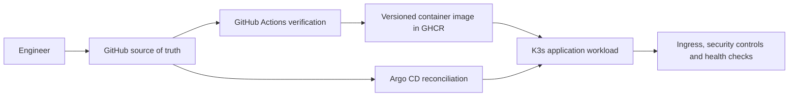

# VinceOps | Cloud & DevOps Engineering Portfolio

> **A hands-on cloud engineering portfolio built around a fictional fintech organization.** Each milestone documents an engineering problem, a practical implementation, technical decisions, verification evidence, and lessons learned.

VinceOps demonstrates the evolution of cloud foundations into containerized application delivery and Kubernetes operations. The projects are **verified development and laboratory exercises**, not a claim that one continuously running production platform is deployed.

## Explore the engineering work

| Phase | Engineering milestone | Implemented capabilities | Documentation |
|---|---|---|---|
| 01 | Cloud foundation & identity | AWS Organizations, account separation, IAM Identity Center, group-based workforce access | [Explore Phase 01](./01-Cloud-Foundation/README.md) |
| 02 | Networking & secure web hosting | VPC, public subnet and routing, EC2, Nginx, DNS, HTTPS, VPC Flow Logs, exposure checks | [Explore Phase 02](./02-Networking-Security/README.md) |
| 02B | Private infrastructure & operational validation | Multi-AZ network, private compute, ALB, Auto Scaling, EFS, monitoring and alerts | [Explore Phase 02B](./02B-Security-Validation/README.MD) |
| 03 | CI foundations | GitHub Actions concepts, workflow validation and troubleshooting | [Explore Phase 03](./03-CI-CD-Pipeline/README.md) |
| 04 | Full-stack containerization | React, Spring Boot, MongoDB, Docker, EC2 and Amazon ECR deployment evidence | [Explore Phase 04](./04-Containerization/README.md) |
| 05 | Kubernetes platform engineering | K3s, declarative configuration, Helm, Argo CD, CI/CD, Ingress/TLS, NetworkPolicy, RBAC and PDB | [Explore all six Kubernetes projects](./05-Kubernetes/README.md) |

**Next engineering milestone:** a single integrated VinceOps capstone will bring infrastructure automation, application delivery, security and observability into one end-to-end design. Terraform and observability are **not treated as separate completed projects** in this portfolio.

## Featured implementations

### Cloud security foundations

AWS Organizations and IAM Identity Center establish the account and workforce-access model. The networking milestones then introduce secure routing, web delivery, application-tier separation and operational evidence.

- [Identity and account architecture](./01-Cloud-Foundation/README.md)
- [VPC, HTTPS and network validation](./02-Networking-Security/README.md)
- [Multi-AZ architecture and evidence](./02B-Security-Validation/evidence/README.md)

### Container delivery and Kubernetes

The container milestone packages an existing full-stack movie application. The Kubernetes milestones progress from an Nginx fundamentals lab to GitOps-managed frontend delivery and cluster-level controls.

- [Container application and deployment evidence](./04-Containerization/README.md)
- [GitOps with Argo CD](./05-Kubernetes/project-04-argocd-gitops/README.md)
- [GitHub Actions, GHCR and deployment promotion](./05-Kubernetes/project-05-ci-cd/README.md)
- [HTTPS, network isolation, RBAC and operations](./05-Kubernetes/project-06-networking-security-operations/README.md)

## Engineering workflow

The diagram summarizes the **Kubernetes frontend delivery track** demonstrated in Projects 04–06; it is not a claim that every earlier AWS lab is currently interconnected.

## Evidence and reproducibility

Implementation work is backed by project-specific source files, manifests, workflow definitions and screenshots. Each project README links to its own evidence and states relevant constraints. Most demonstration environments were temporary, so historical verification does not imply that a public endpoint or cloud cluster remains available today.

**Representative evidence:** [Kubernetes fundamentals](./05-Kubernetes/project-01-kubernetes-fundamentals/screenshots/) · [Argo CD GitOps](./05-Kubernetes/project-04-argocd-gitops/screenshots/) · [Frontend CI/CD](./05-Kubernetes/project-05-ci-cd/screenshots/) · [Kubernetes networking & security](./05-Kubernetes/project-06-networking-security-operations/screenshots/)

## Design principles

- Prefer least-privilege access, intentional network exposure and externalized configuration.
- Keep application and infrastructure configurations in version control; never commit credentials or private keys.
- Validate configuration before deployment and distinguish schema checks from live runtime tests.
- Use container images and declarative state to support reproducible deployments.
- Retain meaningful failure analysis, rollback evidence and operational limitations.
- Document exactly what was verified, without describing development labs as permanently operated production services.

## Repository navigation

The repository follows a **milestone-first** structure. Each phase has its own README; screenshots stay alongside the work they substantiate. Existing implementation paths are kept stable to preserve working references and build pipelines.

## Project context

VinceOps is a fictional fintech engineering scenario used for practical education and portfolio demonstration. Infrastructure and application examples are development exercises rather than a commercial financial service.
